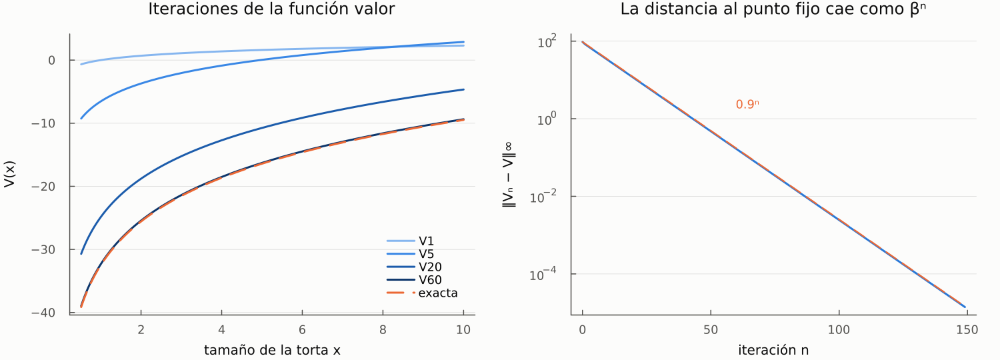

# Repaso: análisis

> Cada concepto tiene una clave (por ejemplo **[A.I5](#ai5)**) y dice en qué
> sesiones se usa. El índice [README.md](README.md) indica qué repasar antes
> de cada sesión. Los fragmentos de Julia corren en el entorno del curso
> (`julia --project=Code`).
>
> - **Básico**: lo que se supone sabido al empezar el curso.
> - **Intermedio**: lo necesario para seguir las clases, las tareas y las
>   notas formales.
> - **Avanzado**: lo necesario para los puntos [Avanzado]: demostraciones y
>   extensiones.

Esta área sostiene sobre todo la programación dinámica: por qué existe la
función valor, por qué la iteración converge y cuándo detenerla.

---

## Nivel básico

<a id="ab1"></a>

### A.B1 Conjuntos y notación
*Todas las sesiones.*

| Símbolo | Se lee | Ejemplo |
|---|---|---|
| $x \in X$ | $x$ pertenece a $X$ | $u \in [0, 1]$ |
| $A \subset B$ | $A$ está contenido en $B$ | $\Gamma(x) \subset \mathbb{R}_+$ |
| $\lbrace x : P(x)\rbrace$ | el conjunto de los $x$ que cumplen $P$ | $\lbrace x \in \mathbb{R}^2_+ : x_1 + x_2 \le B\rbrace$ |
| $\mathbb{R}^n_+$ | vectores con entradas no negativas | |
| $f: X \to Y$ | $f$ asigna a cada punto de $X$ un punto de $Y$ | $V: \mathbb{R}_+ \to \mathbb{R}$ |
| $\forall$, $\exists$ | para todo, existe | |
| $\Rightarrow$, $\Leftrightarrow$ | implica, si y sólo si | |
| $\max_{x \in X} f(x)$ | el valor máximo de $f$ en $X$ | un número |
| $\arg\max_{x \in X} f(x)$ | los puntos donde se alcanza | un conjunto, a veces de un solo punto |

**Valor y maximizador no son lo mismo.** En $\max_{x \in [0, 2]} -(x - 1)^2$,
el máximo es 0 y el maximizador es $x = 1$. En programación dinámica, la
**función valor** $V(x)$ guarda el primero y la **función de política**
$\sigma(x)$, el segundo.

<a id="ab2"></a>

### A.B2 Sucesiones y límites
*Sesiones 6, 16.*

Una sucesión $(x_n)$ **converge** a $x$ si se acerca tanto como se quiera y
se queda cerca: para todo $\varepsilon > 0$ existe $N$ tal que
$\lvert x_n - x\rvert < \varepsilon$ para todo $n \ge N$.

Límites que aparecen todo el tiempo:
- $a^n \to 0$ si $\lvert a\rvert < 1$; diverge si $\lvert a\rvert > 1$.
- $n^k a^n \to 0$ si $\lvert a\rvert < 1$, para cualquier $k$: la
  exponencial le gana a cualquier potencia.
- Una sucesión **monótona y acotada** converge. Por ejemplo, si las
  recompensas cumplen $0 \le r \le \bar r$, las iteraciones de la función
  valor que empiezan en $V_0 = 0$ crecen y nunca pasan de
  $\bar r/(1 - \beta)$ ([A.B3](#ab3)).

En la iteración de la función valor (sesión 16), las $V_n$ son funciones y
la convergencia se mide con la norma del supremo ([A.I4](#ai4)).

<a id="ab3"></a>

### A.B3 Series y descuento
*Sesiones 12, 15, 16.*

Una serie $\sum_{t=0}^\infty a_t$ converge si sus sumas parciales convergen.
La más importante del curso es la **serie geométrica**:

$$
\sum_{t=0}^{T-1}\beta^t = \frac{1 - \beta^T}{1 - \beta},
\qquad
\sum_{t=0}^\infty \beta^t = \frac{1}{1 - \beta} \quad \text{si } \lvert\beta\rvert < 1.
$$

**Valor presente.** Recibir $u$ en cada periodo para siempre, descontado con
$\beta$, vale $u/(1 - \beta)$. Si el flujo crece a la tasa $g$, vale
$u/\big(1 - \beta(1 + g)\big)$, siempre que $\beta(1 + g) < 1$; si no, la
suma es infinita y el problema de optimización deja de estar bien planteado.

La versión continua es $\int_0^\infty e^{-\rho t}\thinspace dt = 1/\rho$
([C.B4](calculo.md#cb4)). Con $\beta = e^{-\rho}$ y $\rho$ pequeño,
$1/(1 - \beta) \approx 1/\rho$.

---

## Nivel intermedio

<a id="ai1"></a>

### A.I1 Supremo, máximo y correspondencias
*Sesiones 15, 16.*

El **supremo** $\sup X$ de un conjunto de números es su menor cota
superior; el **máximo** es un supremo que pertenece al conjunto. Todo
conjunto no vacío y acotado superiormente tiene supremo, pero no
necesariamente máximo: $\sup [0, 1) = 1$, y $[0, 1)$ no tiene máximo.

**Por qué importa.** El problema $\max_{x \in [0, 1)} x$ no tiene solución.
Antes de escribir "max" hay que saber que el máximo se alcanza
([A.I3](#ai3)); si no, se escribe "sup".

**Correspondencias.** En programación dinámica, lo que se puede elegir
depende del estado: si se tiene una torta de tamaño $x$, se puede consumir
cualquier $c \in [0, x]$. Una **correspondencia** $\Gamma$ asigna a cada
estado $x$ un **conjunto** $\Gamma(x)$ de acciones factibles. La ecuación de
Bellman maximiza sobre $\Gamma(x)$:

$$
V(x) = \max_{u \in \Gamma(x)}\big\lbrace r(x, u) + \beta V\big(g(x, u)\big)\big\rbrace.
$$

<a id="ai2"></a>

### A.I2 Conjuntos abiertos, cerrados, acotados y compactos
*Sesiones 2, 15.*

En $\mathbb{R}^n$:
- $X$ es **acotado** si cabe en una bola de radio finito.
- $X$ es **cerrado** si contiene los límites de sus sucesiones convergentes:
  si $x_n \in X$ y $x_n \to x$, entonces $x \in X$. Los conjuntos definidos
  con desigualdades no estrictas de funciones continuas
  ($g(x) \le c$) son cerrados.
- $X$ es **abierto** si alrededor de cada punto hay una bola contenida en
  $X$. Las desigualdades estrictas definen abiertos.
- $X$ es **compacto** si es cerrado y acotado (teorema de Heine-Borel).

Un conjunto puede no ser ni abierto ni cerrado, como $[0, 1)$. La
intersección de cerrados es cerrada; por eso un conjunto definido por varias
desigualdades no estrictas, como un conjunto presupuestal, es cerrado.

**Ejemplos.** El conjunto presupuestal
$\lbrace x \in \mathbb{R}^2_+ : p_1x_1 + p_2x_2 \le B\rbrace$ con precios positivos es
compacto. $[0, 1)$ es acotado pero no cerrado. $\mathbb{R}_+$ es cerrado
pero no acotado.

<a id="ai3"></a>

### A.I3 Continuidad y el teorema de Weierstrass
*Sesiones 2, 15, 16.*

$f$ es **continua** en $x$ si $x_n \to x$ implica $f(x_n) \to f(x)$.

**Teorema (Weierstrass).** Una función continua en un conjunto compacto no
vacío alcanza un máximo y un mínimo.

Es el resultado que garantiza que un problema de optimización tiene
solución. Cuando falla alguna hipótesis, el máximo puede no existir:

| Hipótesis que falla | Ejemplo sin máximo |
|---|---|
| Conjunto no cerrado | $\max_{x \in [0, 1)} x$ |
| Conjunto no acotado | $\max_{x \ge 0} x$ |
| Función no continua | $f(x) = x$ en $[0, 1)$ y $f(1) = 0$, en $[0, 1]$ |

**En la ecuación de Bellman**, si $r$, la ley de movimiento $g$ y $V$ son
continuas y $\Gamma(x)$ es compacto y no vacío, el objetivo
$r(x, u) + \beta V(g(x, u))$ es continuo en $u$ y el máximo en cada estado
existe.

<a id="ai4"></a>

### A.I4 Normas y distancia entre funciones
*Sesiones 16, 17.*

Una **norma** mide tamaños y una **distancia** (métrica) mide qué tan lejos
están dos objetos: $d(x, y) = \lVert x - y\rVert$. En $\mathbb{R}^n$, las
más usadas son $\lVert x\rVert_2 = \sqrt{\sum x_i^2}$ y
$\lVert x\rVert_\infty = \max_i\lvert x_i\rvert$.

Para **funciones** acotadas en un conjunto $X$, la **norma del supremo** es

$$
\lVert f\rVert_\infty = \sup_{x \in X}\lvert f(x)\rvert,
\qquad
d(f, g) = \sup_{x \in X}\lvert f(x) - g(x)\rvert:
$$

la mayor diferencia entre las dos gráficas. Que $V_n \to V$ en esta norma
significa que la aproximación es buena **en todos los estados a la vez**
(convergencia uniforme).

En la computadora, una función se guarda como sus valores en una malla, y
la norma del supremo se vuelve `maximum(abs.(V1 .- V0))`.

<a id="ai5"></a>

### A.I5 Iteración de punto fijo y contracciones en una dimensión
*Sesiones 6, 16.*

Un **punto fijo** de $g$ es un $x^\ast$ con $g(x^\ast) = x^\ast$. La
**iteración** $x_{n+1} = g(x_n)$ busca puntos fijos.

$g$ es una **contracción** de módulo $\beta < 1$ si

$$
\lvert g(x) - g(y)\rvert \le \beta\thinspace\lvert x - y\rvert
\qquad \text{para todo } x, y.
$$

Si $g$ manda un intervalo cerrado $I$ en sí mismo y
$\lvert g'(x)\rvert \le \beta < 1$ en todo $I$, el teorema del valor medio
dice que es una contracción en $I$. Entonces tiene un único punto fijo en
$I$ y la iteración converge a él desde cualquier punto de $I$, con error
$\lvert x_n - x^\ast\rvert \le \beta^n\lvert x_0 - x^\ast\rvert$: cada
iteración multiplica el error por $\beta$ o menos.

**La cota debe ser uniforme.** No basta con $\lvert g'(x)\rvert < 1$ en
cada punto: $g(x) = x + 1/x$ en $[1, \infty)$ tiene $g'(x) = 1 - 1/x^2 < 1$,
pero $g(x) > x$ siempre y no tiene punto fijo. La derivada se acerca a 1
cuando $x$ crece, y no hay un $\beta < 1$ que sirva para todo el dominio.

**El ejemplo más simple de Bellman.** Recibir $u = 1$ por periodo con
$\beta = 0.9$: el valor cumple $v = 1 + 0.9v$, con punto fijo $v^\ast = 10$.
La iteración $v_{n+1} = 1 + 0.9v_n$ es una contracción de módulo 0.9.

```julia
g(v) = 1 + 0.9v
v = 0.0; errores = Float64[]
for n in 1:50
    global v = g(v); push!(errores, abs(v - 10))
end
v, errores[10] / errores[9]        # ≈ (9.948, 0.9): el error cae 10% por iteración
```

---

## Nivel avanzado

<a id="aa1"></a>

### A.A1 Espacios métricos completos
*Sesión 16.*

Un **espacio métrico** es un conjunto con una distancia $d$ que cumple
$d(x, y) \ge 0$ (con igualdad sólo si $x = y$), $d(x, y) = d(y, x)$ y la
desigualdad del triángulo $d(x, z) \le d(x, y) + d(y, z)$.

Una sucesión es **de Cauchy** si sus términos se acercan entre sí: para todo
$\varepsilon > 0$ existe $N$ con $d(x_n, x_m) < \varepsilon$ para
$n, m \ge N$. Un espacio es **completo** si toda sucesión de Cauchy converge
a un punto **del espacio**.

| Espacio | ¿Completo? |
|---|---|
| $\mathbb{R}^n$ con cualquier norma | Sí |
| $\mathbb{Q}$ (racionales) | No: $1, 1.4, 1.41, 1.414, \dots$ es de Cauchy y su límite $\sqrt2$ no es racional |
| Funciones acotadas en $X$ con $\lVert\cdot\rVert_\infty$ | Sí |
| Funciones continuas y acotadas en $X$ con $\lVert\cdot\rVert_\infty$ | Sí: el límite uniforme de continuas es continuo |

La completitud es lo que permite hablar del límite de la iteración de la
función valor sin conocerlo de antemano.

<a id="aa2"></a>

### A.A2 Teorema del punto fijo de Banach
*Sesiones 16, 17.*

**Teorema.** Sea $(M, d)$ un espacio métrico completo y $T: M \to M$ una
contracción de módulo $\beta < 1$. Entonces $T$ tiene un único punto fijo
$x^\ast$, y para cualquier $x_0$ la sucesión $x_{n+1} = Tx_n$ converge a
$x^\ast$.

*Demostración.* Por inducción, $d(x_{n+1}, x_n) \le \beta^n d(x_1, x_0)$.
Para $m > n$, con la desigualdad del triángulo y la serie geométrica,

$$
d(x_m, x_n) \le \sum_{k=n}^{m-1}\beta^k d(x_1, x_0) \le \frac{\beta^n}{1 - \beta}\thinspace d(x_1, x_0) \to 0,
$$

así que la sucesión es de Cauchy y converge a algún $x^\ast \in M$ por
completitud. Como $T$ es continua (toda contracción lo es),
$Tx^\ast = \lim Tx_n = \lim x_{n+1} = x^\ast$. Si $y^\ast$ fuera otro punto
fijo, $d(x^\ast, y^\ast) = d(Tx^\ast, Ty^\ast) \le \beta d(x^\ast, y^\ast)$,
lo que obliga a $d(x^\ast, y^\ast) = 0$. $\square$

**Cotas de error.**
- *A priori*: $d(x_n, x^\ast) \le \beta^n d(x_0, x^\ast)$.
- *A posteriori*: $d(x_n, x^\ast) \le \dfrac{\beta}{1 - \beta}\thinspace d(x_n, x_{n-1})$.
  Sale de $d(x_n, x^\ast) \le d(x_n, x_{n+1}) + d(x_{n+1}, x^\ast) \le \beta d(x_{n-1}, x_n) + \beta d(x_n, x^\ast)$.

**Regla de paro para la iteración de la función valor.** Para garantizar un
error menor que $\varepsilon$, basta detenerse cuando
$\lVert V_n - V_{n-1}\rVert_\infty \le \varepsilon(1 - \beta)/\beta$. Con
$\beta = 0.95$, eso es una diferencia 19 veces menor que la tolerancia
deseada: una diferencia pequeña entre iteraciones no garantiza, por sí
sola, estar cerca de la solución.



*Izquierda: iteraciones V₁, V₅, V₂₀ y V₆₀ de la función valor del problema de la torta (utilidad logarítmica, β = 0.9), comparadas con la solución exacta. Derecha: la distancia al punto fijo en norma del supremo cae como 0.9ⁿ, una recta en escala semilog.*

<a id="aa3"></a>

### A.A3 Condiciones de Blackwell
*Sesión 16.*

¿Cómo saber si un operador sobre funciones es una contracción? Sea
$B(X)$ el espacio de funciones acotadas en $X$ con la norma del supremo, y
$T: B(X) \to B(X)$.

**Teorema (Blackwell).** Si $T$ cumple
1. **Monotonía**: $v \le w$ (punto por punto) implica $Tv \le Tw$, y
2. **Descuento**: existe $\beta \in (0, 1)$ con $T(v + c) \le Tv + \beta c$
   para toda constante $c \ge 0$,

entonces $T$ es una contracción de módulo $\beta$.

*Demostración.* Para $v, w \in B(X)$, $v \le w + \lVert v - w\rVert_\infty$.
Por monotonía y descuento,
$Tv \le T\big(w + \lVert v - w\rVert_\infty\big) \le Tw + \beta\lVert v - w\rVert_\infty$.
Intercambiando $v$ y $w$, $\lvert Tv - Tw\rvert \le \beta\lVert v - w\rVert_\infty$
en cada punto. $\square$

**El operador de Bellman**
$(Tv)(x) = \max_{u \in \Gamma(x)}\lbrace r(x, u) + \beta v(g(x, u))\rbrace$ cumple
las dos: si $v \le w$, el máximo con $w$ es mayor; y sumar $c$ a $v$ suma
exactamente $\beta c$ al máximo. Si $r$ es acotada, $T$ manda funciones
acotadas en funciones acotadas y, con Banach ([A.A2](#aa2)), la ecuación de
Bellman tiene una única solución acotada; la iteración converge a ella desde
cualquier $V_0$ acotada.

**Recompensas no acotadas.** Con utilidad logarítmica, como en el problema
de la torta, $r$ no es acotada y el argumento no se aplica tal cual: hacen
falta normas ponderadas u otros argumentos (Sargent y Stachurski; Stokey,
Lucas y Prescott, sec. 4.4). La iteración sigue funcionando en la práctica,
como muestra la figura de [A.A2](#aa2), pero la garantía teórica es otra.

<a id="aa4"></a>

### A.A4 Teorema del máximo de Berge
*Sesión 16.*

**Teorema (Berge).** Sea $r(x, u)$ continua y $\Gamma$ una correspondencia
continua con valores compactos y no vacíos. Entonces
$V(x) = \max_{u \in \Gamma(x)} r(x, u)$ es continua, y el conjunto de
maximizadores $\sigma(x) = \arg\max_{u \in \Gamma(x)} r(x, u)$ es no vacío,
compacto y hemicontinuo superiormente. Si el maximizador es único para cada
$x$, $\sigma$ es una función continua.

**Para qué sirve.** Garantiza que el operador de Bellman manda funciones
continuas a funciones continuas, de modo que la iteración se queda en el
espacio completo de funciones continuas y acotadas ([A.A1](#aa1)). También
garantiza que la política óptima cambia de forma continua con el estado
cuando es única. Es única, por ejemplo, si el objetivo es estrictamente
cóncavo en $u$ ([C.I2](calculo.md#ci2)) y $\Gamma(x)$ es convexo.

<a id="aa5"></a>

### A.A5 Integrales impropias y condiciones al infinito
*Sesión 12.*

Con horizonte infinito, el objetivo
$\int_0^\infty e^{-\rho t}u(c_t)\thinspace dt$ es una **integral impropia**:
$\lim_{T \to \infty}\int_0^T$. Converge si, por ejemplo,
$\lvert u(c_t)\rvert \le Me^{gt}$ con $g < \rho$: el descuento le gana al
crecimiento. Si no converge, comparar trayectorias por su valor deja de
tener sentido, y hay que usar criterios como el de "alcanzar" (*overtaking*),
que es lo que hizo Ramsey sin descuento.

**Transversalidad.** En horizonte finito con $y(T)$ libre, $\lambda(T) = 0$:
el estado sobrante no vale nada. La versión de horizonte infinito más usada
es

$$
\lim_{t \to \infty} e^{-\rho t}\mu(t)\thinspace k(t) = 0:
$$

donde $\mu$ es el coestado a valor corriente. Con el coestado a valor
presente, $\lambda(t) = e^{-\rho t}\mu(t)$, se escribe
$\lim_{t \to \infty}\lambda(t)\thinspace k(t) = 0$. Dice que el valor
presente del capital que queda "al final" debe ser cero, y excluye las
trayectorias que acumulan capital sin consumirlo nunca.

**Cuidado**: la condición $\lim\lambda(t) = 0$ no es necesaria en general en
horizonte infinito (Halkin, 1974). La condición en forma de producto sí lo es
bajo hipótesis usuales en los modelos de crecimiento, y, si el hamiltoniano
es cóncavo, es suficiente junto con las demás condiciones del principio del
máximo (sesión 12).

---

## Autodiagnóstico

<details>
<summary><b>1 (B).</b> ¿Cuánto valen max y argmax de <i>f</i>(<i>x</i>) = 4 − (<i>x</i> − 2)² en [0, 3]? ¿Y en [3, 5]?</summary>

En $[0, 3]$: máximo 4 en $x = 2$. En $[3, 5]$: $f$ decrece, así que el
máximo es $f(3) = 3$ en la esquina $x = 3$.
</details>

<details>
<summary><b>2 (B).</b> ¿Converge <i>x</i><sub><i>n</i></sub> = <i>n</i> · 0.9<sup><i>n</i></sup>? ¿A qué?</summary>

Sí, a 0: la exponencial $0.9^n$ le gana al factor $n$. Primero crece (el
máximo está cerca de $n = 10$) y luego decae.
</details>

<details>
<summary><b>3 (B).</b> Con β = 0.96, ¿cuánto vale hoy recibir 1 por periodo para siempre, empezando hoy? ¿Y empezando el próximo periodo?</summary>

$1/(1 - 0.96) = 25$. Empezando el próximo periodo, $\beta/(1 - \beta) = 24$.
</details>

<details>
<summary><b>4 (B).</b> Un flujo empieza en 1 y crece 5% por periodo, con β = 0.97. ¿Su valor presente es finito?</summary>

No: $\beta(1 + g) = 0.97 \times 1.05 = 1.0185 > 1$, así que los términos
crecen y la suma diverge.
</details>

<details>
<summary><b>5 (B).</b> ¿Cuál es el conjunto factible Γ(<i>x</i>) si con una torta de tamaño <i>x</i> se puede comer cualquier cantidad no negativa que no exceda la torta?</summary>

$\Gamma(x) = [0, x]$: depende del estado. Es compacto y no vacío para todo
$x \ge 0$.
</details>

<details>
<summary><b>6 (I).</b> ¿Tiene máximo <i>f</i>(<i>x</i>, <i>y</i>) = <i>xy</i> en {(<i>x</i>, <i>y</i>) ≥ 0 : <i>x</i> + <i>y</i> < 2}? ¿Y con ≤?</summary>

Con $<$, no: el supremo es 1 (en $x = y = 1$, sobre la recta $x + y = 2$),
que no pertenece al conjunto. Con $\le$, el conjunto es compacto y $f$ es
continua: por Weierstrass hay máximo, que vale 1 en $(1, 1)$.
</details>

<details>
<summary><b>7 (I).</b> ¿Es una contracción <i>g</i>(<i>x</i>) = 0.5 cos <i>x</i> en ℝ? ¿Cuántas iteraciones garantizan un error menor que 10⁻⁶ si |<i>x</i><sub>0</sub> − <i>x</i>*| ≤ 1?</summary>

Sí: $\lvert g'(x)\rvert = 0.5\lvert\sin x\rvert \le 0.5$. Con
$0.5^n \le 10^{-6}$, $n \ge 6\ln 10/\ln 2 \approx 19.9$: bastan 20
iteraciones.
</details>

<details>
<summary><b>8 (I).</b> Dos funciones en la malla {0, 0.5, 1} valen (1, 2, 3) y (1.1, 1.8, 3.05). ¿Cuál es su distancia en norma del supremo?</summary>

$\max(0.1, 0.2, 0.05) = 0.2$.
</details>

<details>
<summary><b>9 (A).</b> En la iteración de la función valor con β = 0.98, la diferencia entre dos iteraciones consecutivas es 10⁻⁴. ¿Qué error garantiza la cota a posteriori?</summary>

$\beta/(1 - \beta) \times 10^{-4} = 49 \times 10^{-4} \approx 0.005$: casi
50 veces la diferencia observada.
</details>

<details>
<summary><b>10 (A).</b> Verifica las condiciones de Blackwell para (<i>Tv</i>)(<i>x</i>) = <i>r</i>(<i>x</i>) + β <i>v</i>(<i>x</i>/2) en las funciones acotadas.</summary>

Monotonía: si $v \le w$, $v(x/2) \le w(x/2)$, así que $Tv \le Tw$.
Descuento: $T(v + c)(x) = r(x) + \beta v(x/2) + \beta c = (Tv)(x) + \beta c$.
Es una contracción de módulo $\beta$ (si $r$ es acotada, $T$ manda funciones
acotadas a funciones acotadas).
</details>

---

## Para profundizar

- Sargent y Stachurski, Vol. I, secs. 1.2–1.3: contracciones, aproximaciones
  sucesivas y su uso en programación dinámica.
- Stokey, Lucas y Prescott (1989), *Recursive Methods in Economic Dynamics*,
  caps. 3–4: espacios métricos, Banach, Blackwell y Berge aplicados a la
  ecuación de Bellman.
- Simon y Blume (1994), caps. 12–13 y 29: sucesiones, conjuntos y
  topología en $\mathbb{R}^n$.
- Halkin, H. (1974). Necessary conditions for optimal control problems with
  infinite horizons. *Econometrica*, 42(2), 267–272.
  https://doi.org/10.2307/1911976
