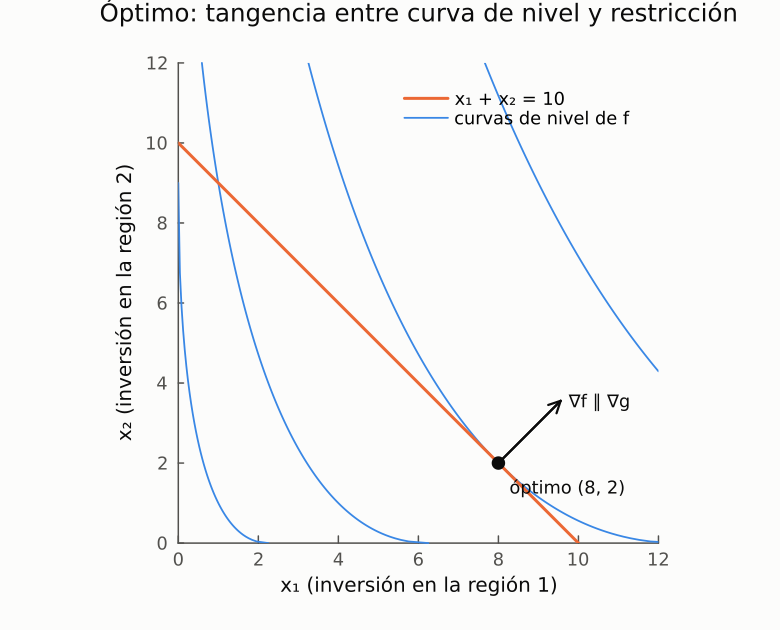

# Repaso: cálculo de una y varias variables

> Cada concepto tiene una clave (por ejemplo **[C.I5](#ci5)**) y dice en qué
> sesiones se usa. El índice [README.md](README.md) indica qué repasar antes
> de cada sesión. Los fragmentos de Julia corren en el entorno del curso
> (`julia --project=Code`).
>
> - **Básico**: lo que se supone sabido al empezar el curso.
> - **Intermedio**: lo necesario para seguir las clases, las tareas y las
>   notas formales.
> - **Avanzado**: lo necesario para los puntos [Avanzado]: demostraciones y
>   extensiones.

---

## Nivel básico

<a id="cb1"></a>

### C.B1 Derivadas y sus reglas
*Sesiones 2, 3, 5, 10.*

$$
f'(x) = \frac{df}{dx} = \lim_{h \to 0}\frac{f(x+h) - f(x)}{h}.
$$

Es la **pendiente** de $f$ en $x$: cuánto cambia $f$ por unidad de cambio en
$x$. En economía, una derivada es un concepto **marginal**: producto marginal,
utilidad marginal, costo marginal.

| $f(x)$ | $f'(x)$ |
|---|---|
| $x^n$ | $n x^{n-1}$ |
| $e^{ax}$ | $a e^{ax}$ |
| $\ln x$ | $1/x$ |
| $a^x$ | $a^x \ln a$ |

Reglas: $(f + g)' = f' + g'$; $(fg)' = f'g + fg'$;
$(f/g)' = (f'g - fg')/g^2$; **regla de la cadena**:
$\big(f(g(x))\big)' = f'(g(x))\thinspace g'(x)$.

La regla de la cadena aparece cada vez que algo depende del tiempo a través
de otra variable. Si el consumo sigue una trayectoria $c(t)$, la utilidad
marginal cambia como $\frac{d}{dt}u'(c(t)) = u''(c)\thinspace\dot c$; así se
obtiene la regla de Keynes-Ramsey en la sesión 12.

**Ejemplo.** Si el producto de una región es $a\ln(1 + x)$ con inversión $x$,
el producto marginal de la inversión es $a/(1+x)$: positivo y decreciente.
Cada peso adicional rinde menos que el anterior.

**Elasticidad.** $\varepsilon = \dfrac{x}{y}\dfrac{dy}{dx} = \dfrac{d\ln y}{d\ln x}$:
el cambio porcentual de $y$ ante un cambio de 1% en $x$. En $y = Ax^\alpha$,
la elasticidad es constante e igual a $\alpha$.

<a id="cb2"></a>

### C.B2 Máximos y mínimos en una variable
*Sesiones 2, 10, 11, 13, 14.*

Para $\max_{x} f(x)$ en un intervalo $[a, b]$:

1. **Puntos interiores**: un máximo en $a < x^\ast < b$ cumple $f'(x^\ast) = 0$
   (condición de primer orden). Si además $f''(x^\ast) < 0$, es un máximo
   local (condición de segundo orden).
2. **Extremos del intervalo**: el máximo también puede estar en $a$ o en $b$,
   **sin que la derivada se anule**. En $a$ hace falta $f'(a) \le 0$; en $b$,
   $f'(b) \ge 0$.

Hay que revisar ambos casos. Una **solución de esquina** es un máximo en el
borde del conjunto factible. Estas condiciones son las de Kuhn-Tucker en una
variable ([C.A1](#ca1)): en $x \ge 0$, el óptimo cumple $f'(x^\ast) \le 0$,
$x^\ast \ge 0$ y $x^\ast f'(x^\ast) = 0$.

**Ejemplo.** $\max_{x \ge 0}\thinspace a\ln(1+x) - px$. La condición interior
$a/(1+x) = p$ da $x = a/p - 1$, válida sólo si $a > p$. Si $a \le p$, el
óptimo es la esquina $x^\ast = 0$: ni el primer peso rinde lo que cuesta.

**Funciones lineales.** Si $f(x) = cx$ en $[a, b]$, el máximo está en $b$ si
$c > 0$, en $a$ si $c < 0$, y cualquier punto sirve si $c = 0$. Ésta es la
lógica de las soluciones **bang-bang** del control óptimo (sesiones 13 y 14):
cuando el hamiltoniano es lineal en el control, el control óptimo salta de un
extremo a otro según el signo de su coeficiente.

<a id="cb3"></a>

### C.B3 Exponencial, logaritmo y crecimiento continuo
*Sesiones 5, 10, 12, 15, 18.*

El **logaritmo natural** $\ln x$ (en Julia, `log(x)`) es la inversa de
$e^x$: $\ln(ab) = \ln a + \ln b$, $\ln(a^b) = b\ln a$, $e^{a+b} = e^a e^b$.

- **Crecimiento exponencial**: $x(t) = x_0 e^{gt}$ crece a la tasa constante
  $g$ y duplica su valor cada $\ln 2/g \approx 0.69/g$ unidades de tiempo.
- **Tasa de crecimiento**: $\dfrac{d}{dt}\ln x(t) = \dfrac{\dot x}{x}$. De
  ahí, la tasa de crecimiento de un producto es la suma de las tasas y la de
  un cociente es la diferencia: si $y = k/l$, entonces
  $\dot y/y = \dot k/k - \dot l/l$.
- **Descuento**: un peso dentro de $t$ años vale hoy $e^{-\rho t}$ en tiempo
  continuo, con tasa de descuento $\rho$, o $\beta^t$ en tiempo discreto, con
  factor de descuento $\beta \in (0, 1)$. Las dos convenciones coinciden si
  $\beta = e^{-\rho}$.

| Tiempo continuo | Tiempo discreto |
|---|---|
| $e^{-\rho t}$ | $\beta^t$ |
| $\dot x = gx$, $x(t) = x_0e^{gt}$ | $x_{t+1} = (1+g)x_t$, $x_t = (1+g)^t x_0$ |
| $\int_0^\infty e^{-\rho t}u(c_t)\thinspace dt$ | $\sum_{t=0}^\infty \beta^t u(c_t)$ |

Una tasa de crecimiento continua $g$ y una discreta $\tilde g$ son
equivalentes si $e^g = 1 + \tilde g$, es decir, $g = \ln(1 + \tilde g) \approx \tilde g$
para tasas pequeñas.

**Derivar una cantidad descontada.** Por la regla del producto,

$$
\frac{d}{dt}\Big(e^{-\rho t}x(t)\Big) = e^{-\rho t}\big(\dot x - \rho x\big).
$$

Esta identidad pasa del hamiltoniano a valor presente al hamiltoniano a
valor corriente (sesión 12) y de la restricción dinámica a la restricción en
valor presente ([D.I2](ecuaciones_diferenciales.md#di2)).

<a id="cb4"></a>

### C.B4 Integrales
*Sesiones 10, 11, 12.*

$\int_a^b f(t)\thinspace dt$ es el área bajo $f$ entre $a$ y $b$, o la
**acumulación** de una tasa: si $\dot K = I(t)$ es la inversión, el capital
acumulado entre $0$ y $T$ es $K(T) - K(0) = \int_0^T I(t)\thinspace dt$.

**Teorema fundamental del cálculo**: si $F' = f$, entonces
$\int_a^b f(t)\thinspace dt = F(b) - F(a)$, y
$\dfrac{d}{dx}\int_a^x f(t)\thinspace dt = f(x)$.

**Valor presente.** Un flujo constante $c$ durante $[0, T]$, descontado a la
tasa $\rho$, vale

$$
\int_0^T c\thinspace e^{-\rho t}\thinspace dt = \frac{c}{\rho}\left(1 - e^{-\rho T}\right)
\quad\longrightarrow\quad \frac{c}{\rho} \quad (T \to \infty).
$$

**Integración por partes**: $\int_a^b u\thinspace dv = \big[uv\big]_a^b - \int_a^b v\thinspace du$.
Es la herramienta que lleva de la perturbación de una trayectoria a la
ecuación de Euler ([C.A3](#ca3)), y la que convierte la restricción
presupuestal dinámica en una restricción en valor presente
([D.I2](ecuaciones_diferenciales.md#di2)).

```julia
ρ, c, T = 0.05, 1.0, 20.0
Δt = 1e-4; ts = 0:Δt:T-Δt
sum(c * exp(-ρ * t) for t in ts) * Δt, c / ρ * (1 - exp(-ρ * T))   # ≈ 12.64 y 12.64
```

<a id="cb5"></a>

### C.B5 Derivadas parciales y gradiente
*Sesiones 2, 3.*

Si $f(x_1, \dots, x_n)$, la **derivada parcial** $\partial f/\partial x_i$
(también $f_{x_i}$ o $f_i$) se calcula derivando respecto a $x_i$ con las
demás variables fijas.

- **Gradiente**: $\nabla f = (f_1, \dots, f_n)$. Apunta en la dirección de
  máximo crecimiento de $f$ y es perpendicular a las **curvas de nivel**
  $f(x) = \text{constante}$.
- En un máximo o mínimo interior, $\nabla f = 0$.

**Ejemplo.** Con $Y = AK^\alpha L^{1-\alpha}$, los productos marginales son
$Y_K = \alpha Y/K$ y $Y_L = (1-\alpha)Y/L$. Por eso, con mercados
competitivos, $\alpha$ es la participación del capital en el ingreso.

---

## Nivel intermedio

<a id="ci1"></a>

### C.I1 Matriz hessiana y condiciones de segundo orden
*Sesión 2.*

La **hessiana** de $f$ es la matriz de segundas derivadas,
$\nabla^2 f = \big(f_{ij}\big)$ con $f_{ij} = \partial^2 f/\partial x_i\partial x_j$.
Si $f$ es suave, es simétrica ($f_{ij} = f_{ji}$, teorema de Young).

Para $\max_x f(x)$ sin restricciones:

| Condición | Qué garantiza |
|---|---|
| $\nabla f(x^\ast) = 0$ | Necesaria para un extremo interior |
| $x^\ast$ es máximo local interior | $\nabla^2 f(x^\ast)$ semidefinida negativa (necesaria de segundo orden) |
| $\nabla f(x^\ast) = 0$ y $\nabla^2 f(x^\ast)$ definida negativa | Máximo local estricto |
| $\nabla f(x^\ast) = 0$ y $f$ cóncava en todo el dominio | Máximo global ([C.I2](#ci2)) |

Cómo decidir si una matriz es definida negativa está en
[L.I4](algebra_lineal.md#li4). En dos variables: $f_{11} < 0$ y
$f_{11}f_{22} - f_{12}^2 > 0$.

La razón está en Taylor ([C.I7](#ci7)): cerca de un punto crítico,
$f(x^\ast + h) \approx f(x^\ast) + \tfrac12 h^\top \nabla^2 f(x^\ast)\thinspace h$.
Si la forma cuadrática es negativa en toda dirección $h$, $f$ baja al
moverse en cualquier dirección.

<a id="ci2"></a>

### C.I2 Concavidad, convexidad y cuasiconcavidad
*Sesiones 2, 11, 13, 16.*

Un conjunto $X$ es **convexo** si contiene el segmento entre dos de sus puntos.
En un conjunto convexo, $f$ es **cóncava** si

$$
f\big(\theta x + (1-\theta)y\big) \ge \theta f(x) + (1-\theta) f(y)
\qquad \text{para todo } x, y \in X,\ \theta \in [0, 1],
$$

es decir, si la cuerda queda por debajo de la gráfica. Es **convexa** si $-f$
es cóncava. Con desigualdad estricta (para $x \ne y$, $0 < \theta < 1$), es
estrictamente cóncava.

**Pruebas prácticas.** Si $f$ es dos veces diferenciable: cóncava si y sólo si
$\nabla^2 f$ es semidefinida negativa en todo $X$ (en una variable,
$f'' \le 0$). Si $\nabla^2 f$ es definida negativa en todo $X$, $f$ es
estrictamente cóncava.

**Por qué importa.** Para $f$ cóncava:
- Todo máximo local es global, y $\nabla f(x^\ast) = 0$ basta para un máximo.
- Si es estrictamente cóncava, el máximo, si existe, es único.
- La suma de cóncavas es cóncava, el producto de una cóncava por una
  constante positiva es cóncavo, y una cóncava compuesta con una función
  lineal (afín) es cóncava.

Ésta es la idea detrás de las condiciones suficientes del curso: la
hessiana orlada en la estática, Mangasarian y Arrow en control óptimo
(sesión 13) y la concavidad de la función valor en programación dinámica
(sesión 16, [C.A4](#ca4)).

**Cuasiconcavidad.** $f$ es **cuasicóncava** si sus conjuntos de nivel
superior $\lbrace x : f(x) \ge c\rbrace$ son convexos para todo $c$. Toda
cóncava es cuasicóncava, pero no al revés: $f(x, y) = xy$ en
$\mathbb{R}^2_+$ es cuasicóncava y no es cóncava.

- En un conjunto factible convexo, todo máximo local de una función
  estrictamente cuasicóncava es global y único. Por eso basta la
  cuasiconcavidad en la teoría del consumidor.
- Pero, a diferencia de la concavidad, $\nabla f(x^\ast) = 0$ no garantiza un
  máximo: $f(x) = x^3$ es cuasicóncava (es monótona) y $x = 0$ no es máximo.
- Una transformación creciente de una cuasicóncava sigue siendo
  cuasicóncava; de una cóncava, puede dejar de ser cóncava ($xy = e^{\ln x + \ln y}$).
- La suma de cuasicóncavas no es, en general, cuasicóncava.

<a id="ci3"></a>

### C.I3 Regla de la cadena en varias variables y diferencial total
*Sesiones 3, 11.*

Si $z = f(x, y)$, el **diferencial total** es

$$
dz = f_x\thinspace dx + f_y\thinspace dy:
$$

el cambio de $z$ cuando $x$ y $y$ cambian un poco al mismo tiempo. Si $x$ y
$y$ dependen del tiempo, $\dot z = f_x\thinspace\dot x + f_y\thinspace\dot y$.

**Ejemplo dinámico.** Con el hamiltoniano $H(t, y, u, \lambda)$ a lo largo de
una trayectoria,

$$
\frac{dH}{dt} = H_t + H_y\thinspace\dot y + H_u\thinspace\dot u + H_\lambda\thinspace\dot\lambda.
$$

En el óptimo interior, $H_u = 0$, $\dot y = H_\lambda$ y
$\dot\lambda = -H_y$, así que todo se cancela salvo $H_t$. Si el problema
no depende explícitamente de $t$, **el hamiltoniano es constante a lo largo
de la trayectoria óptima** (sesión 11).

<a id="ci4"></a>

### C.I4 Teorema de la función implícita
*Sesión 3.*

Si $F(x, \alpha) = 0$ define $x$ como función del parámetro $\alpha$ y
$F_x \ne 0$ en el punto, entonces, cerca de ese punto, existe $x(\alpha)$ y

$$
\frac{dx}{d\alpha} = -\frac{F_\alpha}{F_x}.
$$

Sale de diferenciar $F(x(\alpha), \alpha) = 0$: $F_x\thinspace x' + F_\alpha = 0$.

**Estática comparativa.** Las condiciones de primer orden definen el óptimo
como función implícita de los parámetros. En $\max_x a\ln(1+x) - px$, la
condición $F = a/(1+x) - p = 0$ da

$$
\frac{dx^\ast}{da} = -\frac{1/(1+x)}{-a/(1+x)^2} = \frac{1+x}{a} > 0.
$$

**Versión con sistemas.** Si $F(x, \alpha) = 0$ con $F, x \in \mathbb{R}^n$
y el jacobiano $D_xF$ es invertible,
$D_\alpha x = -(D_xF)^{-1}D_\alpha F$. En la práctica se resuelve el sistema
lineal con la regla de Cramer ([L.B4](algebra_lineal.md#lb4)).

<a id="ci5"></a>

### C.I5 Optimización con restricciones de igualdad: Lagrange
*Sesiones 2, 3.*

Para $\max f(x)$ sujeto a $g(x) = c$, con $x \in \mathbb{R}^n$:

1. Se forma el **lagrangiano** $\mathcal{L}(x, \lambda) = f(x) + \lambda\big(c - g(x)\big)$.
2. Se resuelve $\nabla_x\mathcal{L} = 0$ junto con $g(x) = c$:
   $\nabla f(x^\ast) = \lambda\nabla g(x^\ast)$. Esta condición es necesaria
   si $\nabla g(x^\ast) \ne 0$ (con varias restricciones, si sus gradientes
   son linealmente independientes, [L.A3](algebra_lineal.md#la3)).
3. Se revisa la condición de segundo orden con la **hessiana orlada**
   ([L.I5](algebra_lineal.md#li5)).

**Geometría.** En el óptimo, la curva de nivel de $f$ es tangente a la
restricción: los gradientes son paralelos.

**Precio sombra.** Si $V(c)$ es el valor máximo, entonces
$V'(c) = \lambda$: el multiplicador dice cuánto aumenta el óptimo si se
relaja la restricción en una unidad ([C.A2](#ca2)). En control óptimo, el
coestado $\lambda(t)$ tiene exactamente esta interpretación para el estado
en el tiempo $t$.

**Ejemplo.** Repartir un presupuesto $B$ entre dos regiones con producto
$a_1\sqrt{x_1} + a_2\sqrt{x_2}$. De $a_i/(2\sqrt{x_i}) = \lambda$:

$$
x_i^\ast = \frac{a_i^2}{a_1^2 + a_2^2}\thinspace B,
\qquad
\lambda = \frac12\sqrt{\frac{a_1^2 + a_2^2}{B}},
\qquad
V(B) = \sqrt{(a_1^2 + a_2^2)\thinspace B}.
$$

Se comprueba que $V'(B) = \lambda$. La región más productiva recibe más,
pero no todo: los rendimientos son decrecientes.



*Curvas de nivel de a₁√x₁ + a₂√x₂ con a₁ = 2, a₂ = 1 y la recta x₁ + x₂ = 10. El óptimo es el punto de tangencia: ahí el gradiente de f es paralelo al de la restricción.*

<a id="ci6"></a>

### C.I6 Derivar una integral: regla de Leibniz
*Sesiones 3, 10, 11.*

Si los límites y el integrando dependen de un parámetro $\alpha$,

$$
\frac{d}{d\alpha}\int_{a(\alpha)}^{b(\alpha)} f(t, \alpha)\thinspace dt
= \int_{a(\alpha)}^{b(\alpha)} \frac{\partial f}{\partial\alpha}(t, \alpha)\thinspace dt +
f\big(b(\alpha), \alpha\big)\thinspace b'(\alpha) -
f\big(a(\alpha), \alpha\big)\thinspace a'(\alpha).
$$

Tres usos en el curso:
- **Horizonte libre.** $\dfrac{d}{dT}\displaystyle\int_0^T e^{-\rho t}u(c_t)\thinspace dt = e^{-\rho T}u(c_T)$:
  alargar el horizonte agrega el valor descontado del último instante. Es
  el origen de la condición $H(T) = 0$ cuando $T$ es libre (sesión 11).
- **Perturbar una trayectoria.** Derivar $\int F(t, y + \varepsilon\eta, y' + \varepsilon\eta')\thinspace dt$
  respecto de $\varepsilon$ es el primer paso hacia la ecuación de Euler
  ([C.A3](#ca3)).
- **Estática comparativa de un valor presente.** Cómo cambia un valor
  descontado cuando cambia $\rho$.

<a id="ci7"></a>

### C.I7 Desarrollo de Taylor
*Sesiones 2, 7, 8, 10.*

Cerca de un punto $a$, una función suave se aproxima por un polinomio:

$$
f(x) = f(a) + f'(a)(x-a) + \frac{f''(a)}{2}(x-a)^2 + \cdots
$$

En varias variables, con $h = x - a$:

$$
f(a + h) \approx f(a) + \nabla f(a)^\top h + \tfrac12\thinspace h^\top\nabla^2 f(a)\thinspace h.
$$

Usos en el curso:
- **Primer orden (linealización)**: cerca de un equilibrio $x^\ast$,
  $\dot x = F(x) \approx J(x^\ast)(x - x^\ast)$, donde $J$ es el jacobiano
  ([L.I6](algebra_lineal.md#li6)). Así se decide la estabilidad
  (sesiones 7 y 8).
- **Segundo orden**: justifica las condiciones de segundo orden
  ([C.I1](#ci1)).
- **Aproximaciones útiles**: $e^x \approx 1 + x$ y $\ln(1+x) \approx x$
  para $x$ pequeño. Por eso $\beta = e^{-\rho} \approx 1 - \rho$.

---

## Nivel avanzado

<a id="ca1"></a>

### C.A1 Kuhn-Tucker y calificación de las restricciones
*Sesión 2.*

Para $\max f(x)$ sujeto a $g_j(x) \le c_j$ ($j = 1, \dots, m$) y
$x \ge 0$, con $\mathcal{L} = f(x) + \sum_j \lambda_j\big(c_j - g_j(x)\big)$:

$$
\frac{\partial\mathcal{L}}{\partial x_i} \le 0,\quad x_i \ge 0,\quad x_i\thinspace\frac{\partial\mathcal{L}}{\partial x_i} = 0;
\qquad
c_j - g_j(x) \ge 0,\quad \lambda_j \ge 0,\quad \lambda_j\big[c_j - g_j(x)\big] = 0.
$$

**Holgura complementaria.** Una restricción que no se cumple con igualdad
tiene precio sombra cero; una variable que vale cero puede tener derivada
negativa (en esa dirección, aumentarla no conviene).

**Calificación de las restricciones.** Las condiciones de Kuhn-Tucker son
necesarias sólo si las restricciones activas son "regulares". La condición
más usada pide que los gradientes de las restricciones activas sean
linealmente independientes en el óptimo ([L.A3](algebra_lineal.md#la3)).
Si falla, el óptimo puede no cumplirlas.

**Contraejemplo** (Chiang y Wainwright, sec. 13.2). $\max x_1$ sujeto a
$x_2 - (1 - x_1)^3 \le 0$ y $x_1, x_2 \ge 0$. El óptimo es $(1, 0)$, pero
ahí $\partial\mathcal{L}/\partial x_1 = 1 - 3\lambda(1 - x_1)^2 = 1 > 0$
con $x_1 > 0$: las condiciones fallan. La frontera tiene una cúspide en el
óptimo, y los gradientes de las dos restricciones activas,
$(0, 1)$ y $(0, -1)$, son linealmente dependientes.

**Suficiencia.** Si $f$ es cóncava y las $g_j$ son convexas, todo punto que
cumple Kuhn-Tucker es un máximo global (con $f$ cuasicóncava, bajo
condiciones adicionales; teorema de Arrow-Enthoven).

<a id="ca2"></a>

### C.A2 Teorema de la envolvente
*Sesiones 3, 16, 18.*

**Sin restricciones.** Sea $V(\alpha) = \max_x f(x, \alpha)$ con maximizador
diferenciable $x^\ast(\alpha)$. Entonces

$$
V'(\alpha) = \frac{\partial f}{\partial\alpha}\big(x^\ast(\alpha), \alpha\big).
$$

*Demostración.* $V(\alpha) = f(x^\ast(\alpha), \alpha)$. Por la regla de la
cadena,
$V' = f_x\big(x^\ast, \alpha\big)\thinspace x^{\ast\prime}(\alpha) + f_\alpha\big(x^\ast, \alpha\big)$,
y $f_x = 0$ en el óptimo. $\square$

El efecto indirecto (a través del cambio en $x^\ast$) es de segundo orden:
el óptimo ya era óptimo.

**Con restricciones.** Si $V(\alpha) = \max f(x, \alpha)$ sujeto a
$g(x, \alpha) = 0$, entonces $V'(\alpha) = \partial\mathcal{L}/\partial\alpha$
evaluado en el óptimo. Con $\alpha = c$ en $g(x) = c$, sale
$V'(c) = \lambda$ ([C.I5](#ci5)).

**En programación dinámica** (sesiones 16 y 18). Aplicado a la ecuación de
Bellman $V(x) = \max_u \lbrace r(x, u) + \beta V(g(x, u))\rbrace$, da la **fórmula de
Benveniste-Scheinkman** $V'(x) = r_x + \beta V'(g)\thinspace g_x$, que junto con
la condición de primer orden lleva a la ecuación de Euler en tiempo
discreto.

<a id="ca3"></a>

### C.A3 Funcionales y primera variación
*Sesiones 10, 11.*

Un **funcional** asigna un número a cada función:
$J[y] = \int_0^T F\big(t, y(t), y'(t)\big)\thinspace dt$. Para optimizarlo se
compara la trayectoria candidata $y$ con trayectorias cercanas
$y + \varepsilon\eta$, donde $\eta$ es una perturbación con
$\eta(0) = \eta(T) = 0$ (los extremos están fijos).

**Primera variación.** Con la regla de Leibniz ([C.I6](#ci6)),

$$
\frac{d}{d\varepsilon}J[y + \varepsilon\eta]\Big\vert_{\varepsilon = 0}
= \int_0^T \big(F_y\thinspace\eta + F_{y'}\thinspace\eta'\big)\thinspace dt.
$$

Si $y$ es óptima, esta derivada vale cero para toda $\eta$ admisible.
Integrando por partes el segundo término ([C.B4](#cb4)) y usando
$\eta(0) = \eta(T) = 0$, queda
$\int_0^T \big(F_y - \tfrac{d}{dt}F_{y'}\big)\thinspace\eta\thinspace dt = 0$.

**Lema fundamental del cálculo de variaciones.** Si $g$ es continua y
$\int_0^T g(t)\thinspace\eta(t)\thinspace dt = 0$ para toda $\eta$ continua
con $\eta(0) = \eta(T) = 0$, entonces $g \equiv 0$.

*Idea.* Si $g(t_0) > 0$, por continuidad $g > 0$ en un intervalo alrededor de
$t_0$; una $\eta$ positiva sólo en ese intervalo da integral positiva. $\square$

Con el lema se llega a la ecuación de Euler (sesión 10). Si $y(T)$ es libre,
$\eta(T)$ ya no es cero y aparece la condición terminal $F_{y'} = 0$ en $t = T$.

<a id="ca4"></a>

### C.A4 Concavidad y maximización parcial
*Sesiones 13, 16.*

**Proposición.** Sea $F(x, u)$ conjuntamente cóncava en $(x, u)$ y sea
$\Gamma$ un conjunto convexo de pares factibles $(x, u)$. Entonces
$V(x) = \max_{u : (x, u) \in \Gamma} F(x, u)$ es cóncava en $x$.

*Demostración.* Sean $x, x'$ con maximizadores $u, u'$, y
$\theta \in [0, 1]$. El par $\big(\theta x + (1-\theta)x',\ \theta u + (1-\theta)u'\big)$
es factible por convexidad de $\Gamma$, así que

$$
V\big(\theta x + (1-\theta)x'\big) \ge F\big(\theta x + (1-\theta)x',\ \theta u + (1-\theta)u'\big)
\ge \theta F(x, u) + (1-\theta)F(x', u') = \theta V(x) + (1-\theta)V(x'). \quad\square
$$

Dos usos:
- **Suficiencia de Arrow** (sesión 13): pide que el hamiltoniano maximizado
  respecto del control sea cóncavo en el estado.
- **Programación dinámica** (sesión 16): si $r$ es cóncava y la restricción
  es convexa, el operador de Bellman manda funciones cóncavas a funciones
  cóncavas, y la función valor es cóncava.

---

## Autodiagnóstico

<details>
<summary><b>1 (B).</b> Deriva <i>f</i>(<i>x</i>) = ln(1 + <i>x</i>²) y <i>g</i>(<i>t</i>) = <i>e</i><sup>−ρ<i>t</i></sup> <i>t</i>.</summary>

Regla de la cadena: $f'(x) = 2x/(1 + x^2)$. Producto:
$g'(t) = e^{-\rho t} - \rho t\thinspace e^{-\rho t} = (1 - \rho t)\thinspace e^{-\rho t}$.
</details>

<details>
<summary><b>2 (B).</b> Maximiza <i>f</i>(<i>x</i>) = 3<i>x</i> − <i>x</i>² en [0, 1]. ¿Es solución interior o de esquina?</summary>

$f'(x) = 3 - 2x = 0$ da $x = 1.5$, fuera del intervalo. En $[0, 1]$,
$f' > 0$, así que el máximo es la esquina $x^\ast = 1$, con $f'(1) = 1 \ge 0$.
</details>

<details>
<summary><b>3 (B).</b> El ingreso de una región crece 2% al año y su población 0.5%. ¿A qué tasa crece el ingreso per cápita? ¿En cuántos años se duplica?</summary>

2% − 0.5% = 1.5%, porque la tasa de crecimiento de un cociente es la
diferencia de las tasas. Se duplica en $\ln 2/0.015 \approx 46$ años.
</details>

<details>
<summary><b>4 (B).</b> ¿Cuánto vale hoy un flujo perpetuo de 100 al año con ρ = 4%?</summary>

$\int_0^\infty 100\thinspace e^{-0.04t}\thinspace dt = 100/0.04 = 2500$.
</details>

<details>
<summary><b>5 (B).</b> Calcula el gradiente de <i>f</i>(<i>x</i>, <i>y</i>) = <i>x</i><sup>0.3</sup><i>y</i><sup>0.7</sup> en (1, 1).</summary>

$f_x = 0.3\thinspace x^{-0.7}y^{0.7}$ y $f_y = 0.7\thinspace x^{0.3}y^{-0.3}$;
en $(1, 1)$, $\nabla f = (0.3, 0.7)$.
</details>

<details>
<summary><b>6 (I).</b> ¿Es cóncava <i>f</i>(<i>x</i>, <i>y</i>) = ln <i>x</i> + ln <i>y</i> en el ortante positivo? ¿Y <i>g</i> = <i>xy</i>?</summary>

$\nabla^2 f = \mathrm{diag}(-1/x^2, -1/y^2)$ es definida negativa: $f$ es
estrictamente cóncava. Para $g$, la hessiana tiene filas $(0, 1)$ y
$(1, 0)$, con determinante $-1 < 0$: es indefinida y $g$ no es cóncava. Sí es
cuasicóncava, porque $g = e^{f}$ es una transformación creciente de una
cóncava.
</details>

<details>
<summary><b>7 (I).</b> Maximiza <i>x</i><i>y</i> sujeto a <i>x</i> + 2<i>y</i> = 8. ¿Cuánto vale el multiplicador y qué significa?</summary>

$y = \lambda$, $x = 2\lambda$; con $x + 2y = 8$, $\lambda = 2$, $x = 4$,
$y = 2$, $V = 8$. Con presupuesto $c$, $V(c) = c^2/8$ y $V'(8) = 2 = \lambda$:
una unidad más de presupuesto aumenta el óptimo en unas 2 unidades.
</details>

<details>
<summary><b>8 (I).</b> La condición de primer orden de un problema es <i>a</i>/(1 + <i>x</i>) = <i>p</i>. Usa el teorema de la función implícita para obtener d<i>x</i>/d<i>p</i>.</summary>

Con $F = a/(1+x) - p$: $F_p = -1$ y $F_x = -a/(1+x)^2$. Entonces
$dx/dp = -F_p/F_x = -(1+x)^2/a < 0$. Comprobación: $x = a/p - 1$ da
$dx/dp = -a/p^2 = -(1+x)^2/a$.
</details>

<details>
<summary><b>9 (A).</b> Sea <i>V</i>(α) = max<sub><i>x</i></sub> {α<i>x</i> − <i>x</i>²/2}. Calcula <i>V</i>′(α) directamente y con el teorema de la envolvente.</summary>

$x^\ast = \alpha$ y $V = \alpha^2/2$, así que $V' = \alpha$. Con la envolvente,
$V' = \partial f/\partial\alpha = x^\ast = \alpha$, sin necesidad de resolver
antes $V$.
</details>

<details>
<summary><b>10 (A).</b> Escribe la primera variación de <i>J</i>[<i>y</i>] = ∫<sub>0</sub><sup>1</sup> (<i>y</i>′² + <i>y</i>²) <i>dt</i> y la ecuación que debe cumplir el óptimo.</summary>

$F_y = 2y$, $F_{y'} = 2y'$. La primera variación es
$\int_0^1 (2y\eta + 2y'\eta')\thinspace dt$; integrando por partes,
$\int_0^1 (2y - 2y'')\eta\thinspace dt = 0$, así que $y'' = y$. Su solución
general es $y = c_1e^t + c_2e^{-t}$ ([D.I3](ecuaciones_diferenciales.md#di3)).
</details>

---

## Para profundizar

- Chiang y Wainwright (2006), caps. 8–13: diferenciación, estática
  comparativa, optimización libre, con restricciones de igualdad y
  Kuhn-Tucker.
- Becerril Fonseca, Jardón Arcos y Reyes Victoria (2002): cálculo
  diferencial en varias variables, en español.
- Simon y Blume (1994), caps. 14–21: el mismo material con más rigor.
- Chiang (1992), caps. 1–2: funcionales y ecuación de Euler.
