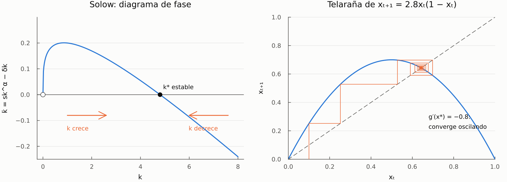
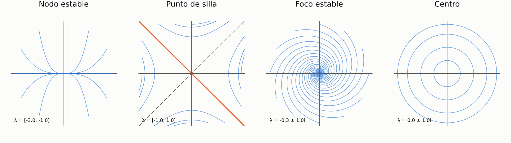
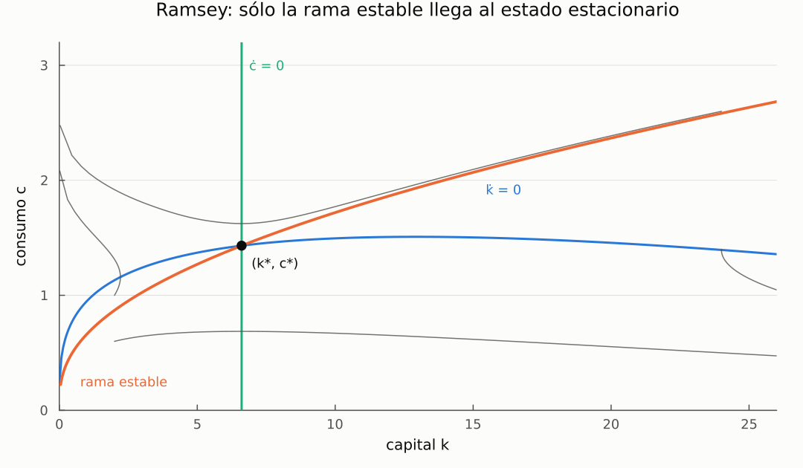

# Repaso: ecuaciones diferenciales y en diferencias

> Cada concepto tiene una clave (por ejemplo **[D.I5](#di5)**) y dice en qué
> sesiones se usa. El índice [README.md](README.md) indica qué repasar antes
> de cada sesión. Los fragmentos de Julia corren en el entorno del curso
> (`julia --project=Code`).
>
> - **Básico**: lo que se supone sabido al empezar el curso.
> - **Intermedio**: lo necesario para seguir las clases, las tareas y las
>   notas formales.
> - **Avanzado**: lo necesario para los puntos [Avanzado]: demostraciones y
>   extensiones.

---

## Nivel básico

<a id="db1"></a>

### D.B1 Ecuaciones diferenciales y en diferencias
*Sesiones 5, 6.*

Una **ecuación diferencial** relaciona una función del tiempo con sus
derivadas: $\dot x = dx/dt = f(x, t)$. Una **ecuación en diferencias**
relaciona los valores de una sucesión en periodos sucesivos:
$x_{t+1} = g(x_t, t)$. En ambos casos, la incógnita es una **trayectoria**
completa, no un número.

- El **orden** es la derivada (o el rezago) más alto que aparece:
  $\ddot x + \dot x = 0$ es de segundo orden; $x_{t+2} = x_{t+1} + x_t$,
  también.
- Es **autónoma** si $f$ no depende explícitamente de $t$:
  $\dot x = f(x)$.
- Es **lineal** si $x$ y sus derivadas aparecen sólo en forma lineal:
  $\dot x + a(t)x = b(t)$.
- Una ecuación de orden $n$ tiene una familia de soluciones con $n$
  constantes; las **condiciones iniciales** (o de frontera, [D.I7](#di7))
  eligen una.

**En el curso.** El capital regional ($\dot K = sY - \delta K$), la riqueza
de un hogar ($\dot w = rw - c$) y el coestado del control óptimo
($\dot\lambda = -\partial H/\partial y$) son ecuaciones diferenciales. En
programación dinámica, las trayectorias siguen ecuaciones en diferencias.

<a id="db2"></a>

### D.B2 Crecimiento y decaimiento exponencial
*Sesiones 5, 6.*

La ecuación más simple, y la que está detrás de todas las demás:

| Ecuación | Solución | Converge a 0 si | Diverge si |
|---|---|---|---|
| $\dot x = ax$ | $x(t) = x_0e^{at}$ | $a < 0$ | $a > 0$ |
| $x_{t+1} = ax_t$ | $x_t = a^tx_0$ | $\lvert a\rvert < 1$ | $\lvert a\rvert > 1$ |

- En tiempo continuo, la **vida media** de un decaimiento es $\ln 2/\lvert a\rvert$.
- En tiempo discreto, si $a < 0$ la trayectoria cambia de signo cada periodo:
  **oscila**. Esto no tiene análogo en una ecuación continua de primer orden.

<a id="db3"></a>

### D.B3 Simular: el método de Euler e iterar
*Sesiones 5, 9.*

Una ecuación en diferencias se simula iterándola. Una ecuación diferencial
se aproxima con pasos pequeños $\Delta t$ (**método de Euler**):

$$
x_{k+1} = x_k + f(x_k, t_k)\thinspace\Delta t,
\qquad t_k = k\thinspace\Delta t.
$$

El error es proporcional a $\Delta t$; en el Laboratorio 1 se usan métodos
mucho más precisos ([N.I3](metodos_numericos.md#ni3)).

```julia
f(x) = -0.5x                               # ẋ = -0.5x, x(0) = 1
function euler(f, x0, Δt, n)
    x = zeros(n + 1); x[1] = x0
    for k in 1:n; x[k+1] = x[k] + f(x[k]) * Δt; end
    x
end
euler(f, 1.0, 0.01, 200)[end], exp(-0.5 * 2)   # ≈ 0.3670 y 0.3679
```

<a id="db4"></a>

### D.B4 Variables separables
*Sesión 5.*

Si $\dot x = g(t)\thinspace h(x)$, se separa e integra:

$$
\int\frac{dx}{h(x)} = \int g(t)\thinspace dt + C.
$$

**Ejemplo.** $\dot x = tx$: $\ln\lvert x\rvert = t^2/2 + C$, así que
$x(t) = x_0e^{t^2/2}$.

**Ejemplo: la logística.** $\dot x = rx(1 - x/K)$. Con fracciones parciales,
$x(t) = K/\big(1 + \frac{K - x_0}{x_0}e^{-rt}\big)$: crece en forma de S
hasta la capacidad $K$.

---

## Nivel intermedio

<a id="di1"></a>

### D.I1 Lineales de primer orden con coeficientes constantes
*Sesiones 5, 6.*

| | Tiempo continuo | Tiempo discreto |
|---|---|---|
| Ecuación | $\dot y + ay = b$ | $y_{t+1} = ay_t + b$ |
| Equilibrio | $y^\ast = b/a$ (si $a \ne 0$) | $y^\ast = b/(1 - a)$ (si $a \ne 1$) |
| Solución | $y(t) = (y_0 - y^\ast)e^{-at} + y^\ast$ | $y_t = (y_0 - y^\ast)a^t + y^\ast$ |
| Estable si | $a > 0$ | $\lvert a\rvert < 1$ |
| Oscila si | nunca | $a < 0$ |

La receta general: **solución = equilibrio + desviación que decae (o
crece)**. La desviación $y - y^\ast$ resuelve la ecuación homogénea
($b = 0$, [D.B2](#db2)). Si $a = 0$ en tiempo continuo (o $a = 1$ en
discreto), no hay equilibrio: $y$ crece linealmente, $y(t) = y_0 + bt$.

**Ejemplo: convergencia regional.** Si la brecha de ingreso de una región
respecto de su estado estacionario cumple $\dot y = -\beta(y - y^\ast)$, la
brecha se cierra a la tasa $\beta$ y su vida media es $\ln 2/\beta$. Con la
"regla del 2%" de la literatura de convergencia, $\beta = 0.02$, la mitad de
la brecha tarda unos 35 años en cerrarse.

<a id="di2"></a>

### D.I2 Lineales de primer orden con coeficientes variables
*Sesiones 5, 11, 12, 14.*

Para $\dot y + a(t)y = b(t)$, se multiplica por el **factor integrante**
$e^{A(t)}$, con $A(t) = \int_0^t a(s)\thinspace ds$. El lado izquierdo se
vuelve $\frac{d}{dt}\big(e^{A(t)}y\big)$, y al integrar:

$$
y(t) = e^{-A(t)}\left[y_0 + \int_0^t e^{A(s)}\thinspace b(s)\thinspace ds\right].
$$

**Ejemplo: la restricción presupuestal.** La riqueza $w$ de un hogar rinde
la tasa $r$ y financia el consumo: $\dot w = rw - c(t)$, con $w(0) = w_0$.
En la forma general, el coeficiente es $-r$ y el término independiente,
$-c(t)$, así que

$$
w(t) = e^{rt}\left[w_0 - \int_0^t e^{-rs}c(s)\thinspace ds\right].
$$

Si se exige $w(T) = 0$, queda $\int_0^T e^{-rs}c(s)\thinspace ds = w_0$: el
valor presente del consumo es igual a la riqueza inicial. La restricción
dinámica es equivalente a una restricción en valor presente.

**Resolver hacia atrás.** Las ecuaciones del coestado vienen con condición
**terminal** $y(T)$, no inicial. Integrando
$\frac{d}{dt}\big(e^{A(t)}y\big) = e^{A(t)}b(t)$ entre $t$ y $T$:

$$
y(t) = e^{A(T) - A(t)}\thinspace y(T) - \int_t^T e^{A(s) - A(t)}\thinspace b(s)\thinspace ds.
$$

Por ejemplo, $\dot p = -\gamma p$ con $p(T) = v$ (coeficiente $\gamma$
constante, sin término independiente) tiene solución
$p(t) = v\thinspace e^{\gamma(T - t)}$: el precio sombra del capital es mayor
cuanto más tiempo queda para que rinda. Es el tipo de cálculo del caso de
las dos regiones (sesión 14).

<a id="di3"></a>

### D.I3 Lineales de segundo orden
*Sesiones 7, 10.*

Para $\ddot y + a_1\dot y + a_2y = b$ con $a_2 \ne 0$: el equilibrio es
$y^\ast = b/a_2$ y la desviación es combinación de soluciones
$e^{rt}$, donde $r$ es raíz de la **ecuación característica**
$r^2 + a_1r + a_2 = 0$.

| Raíces | Solución de la homogénea | Comportamiento |
|---|---|---|
| Reales distintas $r_1, r_2$ | $c_1e^{r_1t} + c_2e^{r_2t}$ | Monótono |
| Repetida $r$ | $(c_1 + c_2t)\thinspace e^{rt}$ | Monótono |
| Complejas $\alpha \pm i\omega$ | $e^{\alpha t}(c_1\cos\omega t + c_2\sin\omega t)$ | Oscila |

Es estable (las dos raíces con parte real negativa) si y sólo si $a_1 > 0$
y $a_2 > 0$.

**Tiempo discreto.** Para $y_{t+2} + a_1y_{t+1} + a_2y_t = b$, se prueba con
$m^t$: $m^2 + a_1m + a_2 = 0$. Es estable si las dos raíces tienen módulo
menor que 1, lo que equivale a $1 + a_1 + a_2 > 0$, $1 - a_1 + a_2 > 0$ y
$a_2 < 1$.

**En el cálculo de variaciones** (sesión 10). La ecuación de Euler suele ser
de segundo orden. Por ejemplo, minimizar $\int_0^T (y'^2 + y^2)\thinspace dt$
da $\ddot y = y$, con raíces $\pm 1$: $y = c_1e^t + c_2e^{-t}$. Las dos
constantes las fijan las condiciones $y(0)$ y $y(T)$; si $T \to \infty$ y
se pide que $y$ no explote, $c_1 = 0$. Es el primer ejemplo de un punto de
silla en optimización dinámica.

<a id="di4"></a>

### D.I4 Puntos fijos y diagramas de fase en una dimensión
*Sesión 6.*

**Tiempo continuo, $\dot x = f(x)$.** Un punto fijo cumple $f(x^\ast) = 0$.
Es estable si $f'(x^\ast) < 0$ e inestable si $f'(x^\ast) > 0$. El
**diagrama de fase** se dibuja sin resolver nada: donde $f > 0$, $x$ crece;
donde $f < 0$, decrece.

**Ejemplo: Solow.** $\dot k = sk^\alpha - \delta k$. Además de $k = 0$, el
punto fijo es $k^\ast = (s/\delta)^{1/(1-\alpha)}$, con
$f'(k^\ast) = -(1 - \alpha)\delta < 0$: estable. Toda región con $k > 0$
converge a $k^\ast$.

**Tiempo discreto, $x_{t+1} = g(x_t)$.** Un punto fijo cumple
$g(x^\ast) = x^\ast$:

| $g'(x^\ast)$ | Comportamiento cerca de $x^\ast$ |
|---|---|
| $0 < g'(x^\ast) < 1$ | Converge monótonamente |
| $-1 < g'(x^\ast) < 0$ | Converge oscilando |
| $\lvert g'(x^\ast)\rvert > 1$ | Se aleja |

El **diagrama de telaraña** lo muestra: graficar $y = g(x)$ y $y = x$, y
alternar pasos verticales (aplicar $g$) y horizontales (volver a la
diagonal).



*Izquierda: en Solow, k crece donde sk^α > δk y decrece donde no; las flechas convergen a k\*. Derecha: telaraña de x_{t+1} = 2.8x_t(1 − x_t); como g′(x\*) = −0.8, la trayectoria converge oscilando.*

<a id="di5"></a>

### D.I5 Sistemas lineales de dos dimensiones
*Sesión 7.*

Para $\dot x = Ax$ con $A$ de $2 \times 2$, $\tau = \mathrm{tr}\thinspace A$
y $\Delta = \det A$, los eigenvalores ([L.I1](algebra_lineal.md#li1)) son
$\lambda = \big(\tau \pm \sqrt{\tau^2 - 4\Delta}\big)/2$. El origen es:

| Condición | Tipo | Estabilidad |
|---|---|---|
| $\Delta < 0$ | Punto de silla | Inestable, salvo sobre la variedad estable |
| $\Delta > 0$, $\tau < 0$, $\tau^2 \ge 4\Delta$ | Nodo | Estable |
| $\Delta > 0$, $\tau < 0$, $\tau^2 < 4\Delta$ | Foco (espiral) | Estable |
| $\Delta > 0$, $\tau = 0$ | Centro | Órbitas cerradas |
| $\Delta > 0$, $\tau > 0$ | Nodo o foco | Inestable |
| $\Delta = 0$ | Un eigenvalor es cero | Recta de equilibrios (caso no hiperbólico, [D.A1](#da1)) |

**En resumen**: estable si y sólo si $\tau < 0$ y $\Delta > 0$.

Con término constante, $\dot x = Ax + b$, todo vale alrededor del equilibrio
$x^\ast = -A^{-1}b$ ([L.B2](algebra_lineal.md#lb2)). Para sistemas en
tiempo discreto, ver [D.A5](#da5).



*Trayectorias de ẋ = Ax para cuatro matrices. En el punto de silla sólo convergen las que empiezan sobre la recta estable (en naranja).*

<a id="di6"></a>

### D.I6 Diagramas de fase en el plano
*Sesiones 8, 12.*

Para $\dot x = f(x, y)$, $\dot y = g(x, y)$ no lineales:

1. **Isoclinas** (o ceroclinas): las curvas $f = 0$ (donde $x$ no cambia) y
   $g = 0$ (donde $y$ no cambia). Sus intersecciones son los equilibrios.
2. **Flechas**: las isoclinas dividen el plano en regiones; en cada una, el
   signo de $f$ dice si $x$ va a la derecha o a la izquierda, y el de $g$,
   si $y$ sube o baja.
3. **Estabilidad local**: con el jacobiano en cada equilibrio
   ([L.I6](algebra_lineal.md#li6)).
4. **Rama estable**: si el equilibrio es un punto de silla, se dibujan las
   dos trayectorias que llegan a él.

**Ejemplo: Ramsey.** Con $f(k) = k^\alpha$, depreciación $\delta$,
descuento $\rho$ y utilidad CRRA con parámetro $\theta$:

$$
\dot k = k^\alpha - \delta k - c,
\qquad
\frac{\dot c}{c} = \frac{\alpha k^{\alpha - 1} - \delta - \rho}{\theta}.
$$

- La isoclina $\dot k = 0$ es la curva $c = k^\alpha - \delta k$. Por
  encima de ella el consumo excede la inversión neta y $k$ disminuye; por
  debajo, $k$ aumenta. Su máximo está en la **regla de oro**,
  $\alpha k^{\alpha-1} = \delta$.
- La isoclina $\dot c = 0$ es la recta vertical $k = k^\ast$, con
  $\alpha k^{\ast\thinspace\alpha-1} = \delta + \rho$ (**regla de oro
  modificada**). A su izquierda el producto marginal es alto y $c$ crece; a
  su derecha, $c$ decrece. Como $\rho > 0$, $k^\ast$ queda por debajo del
  capital de la regla de oro: la impaciencia hace que no convenga acumular
  hasta ahí.

El equilibrio es un punto de silla. Dado $k_0$, sólo un consumo inicial pone
a la economía sobre la rama estable. Con un consumo mayor, el capital se
agota en tiempo finito; con uno menor, el consumo tiende a cero y el capital
se acumula sin consumirse nunca. La condición de transversalidad descarta
esta última trayectoria (sesión 12).



*Isoclinas de Ramsey (α = 0.3, δ = 0.05, ρ = 0.03, θ = 2) y algunas trayectorias. Sólo la rama estable (en naranja) llega al estado estacionario.*

<a id="di7"></a>

### D.I7 Problemas de valor inicial y de valor en la frontera
*Sesiones 11, 12, 19.*

- **Problema de valor inicial**: todas las condiciones están en $t = 0$.
  Se resuelve avanzando en el tiempo ([D.B3](#db3)).
- **Problema de valor en la frontera**: las condiciones están repartidas
  entre $t = 0$ y $t = T$.

El principio del máximo produce siempre lo segundo: el estado tiene
condición inicial $y(0) = y_0$, y el coestado, condición terminal (por
ejemplo, $\lambda(T) = 0$ si $y(T)$ es libre). No se puede simplemente
avanzar desde $t = 0$, porque se desconoce $\lambda(0)$.

**Método de disparo.** Se adivina $\lambda(0) = s$, se resuelve el problema
de valor inicial hasta $T$ y se mide cuánto falla la condición terminal,
$\phi(s) = \lambda(T; s) - \lambda_T$. Se busca la raíz de $\phi$ con
bisección o Newton ([N.I1](metodos_numericos.md#ni1)). La implementación
está en [N.A1](metodos_numericos.md#na1).

**Ejemplo.** $\ddot y = y$, $y(0) = 1$, $y(1) = 0$. La solución exacta es
$y(t) = \sinh(1 - t)/\sinh 1$, con $\dot y(0) = -\coth 1 \approx -1.313$.
Disparar desde $y(0) = 1$ con pendiente $s$ y ajustar $s$ hasta que
$y(1) = 0$ encuentra ese valor.

---

## Nivel avanzado

<a id="da1"></a>

### D.A1 Linealización y el teorema de Hartman-Grobman
*Sesión 7.*

Sea $x^\ast$ un equilibrio de $\dot x = F(x)$, con $F$ suave, y sea
$J = J(x^\ast)$. El equilibrio es **hiperbólico** si ningún eigenvalor de $J$
tiene parte real cero.

**Teorema (Hartman-Grobman).** Si $x^\ast$ es hiperbólico, existe una
vecindad de $x^\ast$ donde las trayectorias de $\dot x = F(x)$ y las de
$\dot h = Jh$ son equivalentes: una transformación continua lleva unas en
las otras. En particular, $x^\ast$ es asintóticamente estable si todos los
eigenvalores tienen parte real negativa, y es un punto de silla si hay de
ambos signos.

**Los casos no hiperbólicos** quedan fuera del teorema, y ahí la
linealización no decide:
- $\dot x = -x^3$ y $\dot x = x^3$ tienen $f'(0) = 0$; el primero es estable y
  el segundo, inestable.
- $\dot x = -y + \mu x(x^2 + y^2)$, $\dot y = x + \mu y(x^2 + y^2)$ tiene un
  centro en su linealización, pero en coordenadas polares
  $\dot r = \mu r^3$: es una espiral estable si $\mu < 0$ e inestable si
  $\mu > 0$.

<a id="da2"></a>

### D.A2 Variedades estable e inestable
*Sesiones 8, 12.*

**Teorema de la variedad estable.** Si $x^\ast$ es un punto de silla
hiperbólico, el conjunto de condiciones iniciales cuyas trayectorias
convergen a $x^\ast$ es una curva suave (en dimensión 2) que pasa por
$x^\ast$ y es tangente a la recta del eigenvector estable. Es la
**variedad estable**. La **inestable** se define igual, con $t \to -\infty$.

**En los modelos de crecimiento óptimo**, la variedad estable es la gráfica
de la **función de política** $c = \sigma(k)$: el consumo óptimo para cada
nivel de capital.

**Cómo calcularla numéricamente.** Se toma un punto muy cerca del
equilibrio sobre el eigenvector estable, $x^\ast \pm \varepsilon v_s$, y se
integra **hacia atrás en el tiempo**: la dirección estable se vuelve
inestable, y la trayectoria recorre la variedad alejándose de $x^\ast$. Así
se dibujó la rama estable de la figura de [D.I6](#di6).

<a id="da3"></a>

### D.A3 Existencia y unicidad de soluciones
*Sesiones 11, 14.*

**Teorema (Picard-Lindelöf).** Si $f(x, t)$ es continua en $t$ y
**Lipschitz** en $x$ (existe $L$ con
$\lVert f(x, t) - f(y, t)\rVert \le L\lVert x - y\rVert$), entonces
$\dot x = f(x, t)$, $x(0) = x_0$ tiene una solución única en un intervalo
alrededor de 0.

Qué puede fallar sin las hipótesis:
- **No unicidad**: $\dot x = 2\sqrt{\lvert x\rvert}$, $x(0) = 0$, tiene para
  $t \ge 0$ las soluciones $x = 0$ y $x = t^2$. La raíz no es Lipschitz
  en 0.
- **Explosión en tiempo finito**: $\dot x = x^2$, $x(0) = 1$, da
  $x = 1/(1 - t)$, que no existe más allá de $t = 1$. La existencia es sólo
  local.

**Controles discontinuos.** Con un control bang-bang (sesión 14), $f$ salta
en el tiempo de cambio. Basta con que $f$ sea continua por tramos en $t$: la
solución es continua y tiene un "codo" en el cambio (solución en el sentido
de Carathéodory).

<a id="da4"></a>

### D.A4 Funciones de Liapunov
*Sesión 8.*

Sea $x^\ast$ un equilibrio de $\dot x = F(x)$. Una **función de Liapunov** es
una $V$ continua con $V(x^\ast) = 0$, $V(x) > 0$ para $x \ne x^\ast$ cerca de
$x^\ast$, y

$$
\dot V = \nabla V(x)^\top F(x) \le 0.
$$

Entonces $x^\ast$ es estable; si $\dot V < 0$ para $x \ne x^\ast$, es
asintóticamente estable. La ventaja: decide la estabilidad sin resolver la
ecuación y funciona en los casos no hiperbólicos ([D.A1](#da1)).

**Ejemplos.**
- $\dot x = -x^3$ con $V = x^2$: $\dot V = -2x^4 < 0$. Asintóticamente
  estable, aunque $f'(0) = 0$.
- $\dot x = -x + y$, $\dot y = -x - y^3$ con $V = x^2 + y^2$:
  $\dot V = 2x(-x + y) + 2y(-x - y^3) = -2x^2 - 2y^4 < 0$.

<a id="da5"></a>

### D.A5 Sistemas lineales en tiempo discreto
*Sesiones 7, 18.*

Para $x_{t+1} = Ax_t$ con $A$ de $2 \times 2$, $x_t \to 0$ para toda
condición inicial si y sólo si los dos eigenvalores tienen módulo menor que
1 ([L.A2](algebra_lineal.md#la2)). En términos de la traza y el
determinante (**triángulo de estabilidad**):

$$
\lvert\tau\rvert < 1 + \Delta
\qquad\text{y}\qquad
\Delta < 1.
$$

Si un eigenvalor tiene módulo menor que 1 y el otro mayor que 1, el
equilibrio es un **punto de silla discreto**. Aparece al linealizar la
ecuación de Euler del modelo de crecimiento en tiempo discreto (sesión 18):
dado $k_0$, sólo un consumo inicial evita la explosión, igual que en tiempo
continuo.

**Relación con el tiempo continuo.** Discretizar $\dot x = Ax$ con un paso
$h$ da aproximadamente $x_{t+1} = (I + hA)x_t$, cuyos eigenvalores son
$1 + h\lambda$. Un eigenvalor continuo con parte real negativa da
$\lvert 1 + h\lambda\rvert < 1$ sólo si $h$ es suficientemente pequeño: por
eso el método de Euler puede volverse inestable con pasos grandes
([N.A3](metodos_numericos.md#na3)).

---

## Autodiagnóstico

<details>
<summary><b>1 (B).</b> Resuelve ẋ = −0.1<i>x</i> con <i>x</i>(0) = 50. ¿Cuál es la vida media?</summary>

$x(t) = 50\thinspace e^{-0.1t}$. Vida media: $\ln 2/0.1 \approx 6.9$.
</details>

<details>
<summary><b>2 (B).</b> ¿Qué hace <i>x</i><sub><i>t</i>+1</sub> = −0.8<i>x</i><sub><i>t</i></sub> con <i>x</i><sub>0</sub> = 1?</summary>

$x_t = (-0.8)^t$: converge a 0 porque $\lvert -0.8\rvert < 1$, cambiando de
signo cada periodo.
</details>

<details>
<summary><b>3 (B).</b> Escribe dos pasos de Euler con Δ<i>t</i> = 0.1 para ẋ = <i>x</i>, <i>x</i>(0) = 1. Compara con la solución exacta en <i>t</i> = 0.2.</summary>

$x_1 = 1 + 0.1 = 1.1$, $x_2 = 1.1 + 0.11 = 1.21$. Exacta:
$e^{0.2} \approx 1.2214$. El error es de orden $\Delta t$.
</details>

<details>
<summary><b>4 (B).</b> Resuelve ẋ = <i>x</i>²<i>t</i> con <i>x</i>(0) = 1 separando variables.</summary>

$\int x^{-2}dx = \int t\thinspace dt$: $-1/x = t^2/2 - 1$, así que
$x = 1/(1 - t^2/2)$. Explota en $t = \sqrt2$.
</details>

<details>
<summary><b>5 (B).</b> ¿Cuál es el orden de <i>y</i><sub><i>t</i>+2</sub> − 3<i>y</i><sub><i>t</i>+1</sub> + 2<i>y</i><sub><i>t</i></sub> = 0? ¿Es lineal? ¿Es autónoma?</summary>

Segundo orden, lineal y autónoma (los coeficientes no dependen de $t$).
</details>

<details>
<summary><b>6 (I).</b> Resuelve <i>y</i><sub><i>t</i>+1</sub> = 0.5<i>y</i><sub><i>t</i></sub> + 3 con <i>y</i><sub>0</sub> = 0. ¿Cuántos periodos tarda en cubrir el 90% del camino al equilibrio?</summary>

$y^\ast = 3/0.5 = 6$ y $y_t = 6(1 - 0.5^t)$. El 90% se cubre cuando
$0.5^t \le 0.1$: $t \ge \ln 10/\ln 2 \approx 3.3$, es decir, en el cuarto
periodo.
</details>

<details>
<summary><b>7 (I).</b> Resuelve ẏ = −γ<i>y</i> − 1 con <i>y</i>(<i>T</i>) = 0, hacia atrás.</summary>

Equilibrio $y^\ast = -1/\gamma$; $y(t) = (y(T) - y^\ast)e^{-\gamma(t - T)} + y^\ast = \tfrac{1}{\gamma}\big(e^{\gamma(T - t)} - 1\big)$.
Es positiva antes de $T$ y vale cero en $T$.
</details>

<details>
<summary><b>8 (I).</b> Clasifica el equilibrio de ẋ = <i>Ax</i> con <i>A</i> = [[−3, 1], [1, −2]].</summary>

$\tau = -5 < 0$, $\Delta = 6 - 1 = 5 > 0$, $\tau^2 - 4\Delta = 5 > 0$: nodo
estable.
</details>

<details>
<summary><b>9 (A).</b> ¿Por qué no basta la linealización para decidir la estabilidad de ẋ = <i>x</i>² en <i>x</i> = 0? Decídela.</summary>

$f'(0) = 0$: el equilibrio no es hiperbólico. Para $x > 0$, $\dot x > 0$ y
$x$ se aleja; para $x < 0$, $\dot x > 0$ y $x$ se acerca. Es
**semiestable**: atrae por la izquierda y repele por la derecha.
</details>

<details>
<summary><b>10 (A).</b> ¿Es estable <i>x</i><sub><i>t</i>+1</sub> = <i>Ax</i><sub><i>t</i></sub> con <i>A</i> = [[0.5, 0.4], [−0.3, 1.1]]?</summary>

$\tau = 1.6$, $\Delta = 0.55 + 0.12 = 0.67$. $1 + \Delta = 1.67 > 1.6$ y
$\Delta < 1$: sí, está dentro del triángulo de estabilidad. Los eigenvalores
son $0.8 \pm 0.17i$, con módulo $\sqrt{0.67} \approx 0.82$.
</details>

---

## Para profundizar

- Chiang y Wainwright (2006), caps. 15–19: ecuaciones diferenciales y en
  diferencias, sistemas y diagramas de fase. Las secs. 19.5 y 19.6 son las
  clave.
- Strogatz (2015), caps. 2, 5 y 6: flujos en la recta, sistemas lineales y
  el plano de fase. Muy recomendable.
- Sydsæter, Hammond, Seierstad y Strøm, *Further Mathematics for Economic
  Analysis*: ecuaciones diferenciales y en diferencias con ejemplos
  económicos.
