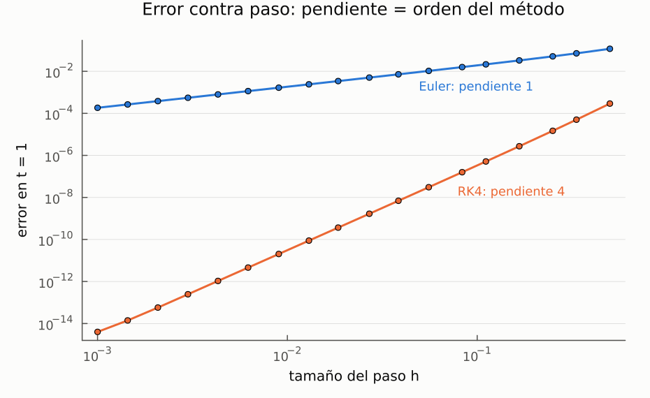

# Repaso: métodos numéricos

> Cada concepto tiene una clave (por ejemplo **[N.I3](#ni3)**) y dice en qué
> sesiones se usa. El índice [README.md](README.md) indica qué repasar antes
> de cada sesión. Los fragmentos de Julia corren en el entorno del curso
> (`julia --project=Code`).
>
> - **Básico**: lo que se supone sabido al empezar el curso. Si nunca has
>   programado, es lo que cubre el Laboratorio 0.
> - **Intermedio**: lo necesario para los laboratorios y la parte en código
>   de las tareas.
> - **Avanzado**: lo necesario para los puntos [Avanzado]: demostraciones y
>   extensiones.

Los métodos de esta área se escriben "a mano" a propósito: un algoritmo de
diez líneas que se entiende vale más, para aprender, que una llamada a una
biblioteca que no se entiende. En los proyectos conviene usar las
bibliotecas.

---

## Nivel básico

<a id="nb1"></a>

### N.B1 Julia en cinco minutos
*Sesión 4 y todos los laboratorios.*

| Concepto | Ejemplo |
|---|---|
| Función de una línea | `f(x) = x^2 - 2` |
| Función de varias líneas | `function f(x) … end` |
| Vector | `v = [1.0, 2.0, 3.0]`; el primer elemento es `v[1]` |
| Rango | `0:0.5:2` o `range(0, 2, length = 5)` |
| Matriz | `A = [1 2; 3 4]` |
| Aplicar a cada elemento (*broadcasting*) | `f.(v)`, `v .^ 2`, `exp.(v)` |
| Comprensión | `[f(x) for x in v if x > 1]` |
| Ciclo | `for i in 1:10 … end` |
| Tupla con nombres (parámetros) | `p = (α = 0.3, δ = 0.05)`; luego `p.α` |

```julia
f(x) = x^2 - 2
xs = 0:0.5:2
f.(xs)                          # [-2.0, -1.75, -1.0, 0.25, 2.0]
[f(x) for x in xs if x > 1]     # [0.25, 2.0]
```

Los índices empiezan en 1, y las letras griegas se escriben con `\alpha` +
Tab. El punto de *broadcasting* es lo que más confunde al principio:
`v^2` falla con un vector, `v .^ 2` eleva cada entrada.

En la consola de Julia, `?` seguido de un nombre muestra su documentación
(por ejemplo, `?range`), y `]` entra al modo de paquetes. Los paquetes del
curso ya están en el entorno `Code/`; basta con `using Plots`, etc.

<a id="nb2"></a>

### N.B2 Gráficas con Plots.jl
*Sesión 4 y todos los laboratorios.*

```julia
using Plots
k = range(0.01, 10, length = 200)
plot(k, 0.3 .* k .^ 0.3; label = "inversión sk^α", xlabel = "k")
plot!(k, 0.05 .* k; label = "depreciación δk")       # el ! agrega a la gráfica actual
```

- `plot` crea una gráfica; `plot!` agrega a la última. `scatter` dibuja
  puntos.
- Las opciones van después de `;`: `label`, `xlabel`, `ylabel`, `title`,
  `xlims`, `yscale = :log10`.
- `contour(x, y, f)` dibuja curvas de nivel ([C.I5](calculo.md#ci5)) y
  `quiver` dibuja flechas para un campo de direcciones
  ([D.I6](ecuaciones_diferenciales.md#di6)).

<a id="nb3"></a>

### N.B3 Cuadernos de Pluto
*Sesión 4 y todos los laboratorios.*

Pluto es **reactivo**: al cambiar una celda, se recalculan
automáticamente todas las que dependen de ella. Eso trae tres reglas:

1. **Cada variable se define en una sola celda.** Si dos celdas definen
   `x`, Pluto marca error.
2. **Una celda es una expresión.** Para varias líneas, se envuelven en
   `begin … end` (las variables quedan disponibles para las demás celdas) o
   en `let … end` (las variables quedan locales).
3. **El orden de las celdas no importa**: Pluto ejecuta según las
   dependencias. El cuaderno siempre es coherente con lo que se ve, sin
   "estado oculto".

Los **deslizadores** de PlutoUI conectan un control con una variable:

```julia
@bind α Slider(0.1:0.05:0.9; default = 0.3, show_value = true)
```

Al mover el deslizador, todas las celdas que usan `α` se recalculan. Así
se exploran los parámetros en los laboratorios.

**Una trampa frecuente.** Pluto sigue qué celdas *definen* y cuáles *usan*
cada variable, pero no detecta cambios hechos "por dentro". Si una celda
define `v = zeros(10)` y otra hace `push!(v, 1.0)` o `v[1] = 2.0`, las
demás celdas no se recalculan y el resultado depende del orden en que se
ejecutaron. La solución es construir el arreglo completo en la celda que lo
define (por ejemplo, con una función que lo devuelva).

<a id="nb4"></a>

### N.B4 Aritmética de punto flotante
*Sesiones 4, 16.*

La computadora guarda los números reales con unos 16 dígitos significativos
(`Float64`). Casi ningún decimal es exacto:

```julia
0.1 + 0.2 == 0.3            # false
0.1 + 0.2 ≈ 0.3             # true: ≈ es isapprox, compara con tolerancia
eps()                       # 2.220446049250313e-16: la precisión relativa
```

Reglas prácticas:
- **Nunca** comparar números reales con `==`. Usar `≈` o
  `abs(a - b) < tol`.
- Los algoritmos iterativos se detienen con una **tolerancia**, no cuando
  "llegan exactamente". Elegirla bien es parte del método
  ([A.A2](analisis.md#aa2)).
- Restar números casi iguales pierde dígitos (ver [N.A4](#na4)).

---

## Nivel intermedio

<a id="ni1"></a>

### N.I1 Raíces de ecuaciones: bisección y Newton
*Sesiones 12, 14, 19.*

Muchos problemas del curso terminan en una ecuación $h(x) = 0$ sin solución
cerrada: un estado estacionario, un tiempo de cambio, una condición
terminal.

**Bisección.** Si $h$ es continua y $h(a)$, $h(b)$ tienen signos opuestos,
hay una raíz en $[a, b]$. Se evalúa el punto medio y se conserva la mitad
donde cambia el signo. El error se reduce a la mitad en cada paso, así que
para una tolerancia $\varepsilon$ hacen falta unos
$\log_2\big((b - a)/\varepsilon\big)$ pasos: **siempre converge, pero
despacio**.

**Newton.** Se reemplaza $h$ por su recta tangente y se busca dónde cruza
el cero:

$$
x_{n+1} = x_n - \frac{h(x_n)}{h'(x_n)}.
$$

Cerca de la raíz, el número de dígitos correctos se duplica en cada paso
(convergencia cuadrática). Pero puede fallar lejos de la raíz o si
$h'(x_n) \approx 0$.

```julia
function biseccion(h, a, b; tol = 1e-10)
    h(a) * h(b) < 0 || error("h debe cambiar de signo en [a, b]")
    while b - a > tol
        m = (a + b) / 2
        h(a) * h(m) <= 0 ? (b = m) : (a = m)
    end
    (a + b) / 2
end
function newton(h, dh, x; tol = 1e-12, maxit = 50)
    for _ in 1:maxit
        paso = h(x) / dh(x); x -= paso
        abs(paso) < tol && return x
    end
    x
end
α, δ, ρ = 0.3, 0.05, 0.03                       # estado estacionario de Ramsey
h(k) = α * k^(α - 1) - (δ + ρ)                  # f'(k) = δ + ρ
dh(k) = α * (α - 1) * k^(α - 2)
biseccion(h, 1.0, 20.0), newton(h, dh, 5.0), (α / (δ + ρ))^(1 / (1 - α))   # los tres ≈ 6.61
```

En la práctica: bisección para encontrar un intervalo seguro y Newton
para refinar. En los proyectos, el paquete `Roots.jl` combina ambas ideas.

<a id="ni2"></a>

### N.I2 Cálculo simbólico con Symbolics.jl
*Sesiones 2, 3, 4.*

Symbolics.jl deriva, simplifica y sustituye expresiones con letras, como se
haría a mano:

```julia
using Symbolics
@variables x a p
foc = Symbolics.derivative(a * log(1 + x) - p * x, x)   # -p + a / (1 + x)
xstar = Symbolics.symbolic_solve(foc ~ 0, x)[1]          # -1 + a / p
substitute(xstar, Dict(a => 2, p => 0.5))                # 3.0
```

Para las condiciones de primer orden de un lagrangiano:

```julia
using Symbolics
@variables x1 x2 λ B a1 a2
L = a1 * sqrt(x1) + a2 * sqrt(x2) + λ * (B - x1 - x2)
Symbolics.gradient(L, [x1, x2, λ])     # [a1/(2√x1) - λ, a2/(2√x2) - λ, B - x1 - x2]
Symbolics.hessian(L, [x1, x2])         # para la condición de segundo orden
```

`symbolic_solve` resuelve bien ecuaciones polinomiales y despejes simples;
los sistemas no lineales suelen requerir despejar a mano o resolverlos
numéricamente ([N.I1](#ni1)). Symbolics también calcula jacobianos
([L.I6](algebra_lineal.md#li6)).

<a id="ni3"></a>

### N.I3 Ecuaciones diferenciales con DifferentialEquations.jl
*Sesiones 9, 12, 14, 19.*

El método de Euler ([D.B3](ecuaciones_diferenciales.md#db3)) tiene error
proporcional al paso. Los métodos de **Runge-Kutta** evalúan la pendiente
varias veces por paso y son mucho más precisos ([N.I6](#ni6)).
DifferentialEquations.jl los implementa con control automático del paso:

```julia
using DifferentialEquations
solow(k, p, t) = p.s * k^p.α - p.δ * k
prob = ODEProblem(solow, 1.0, (0.0, 200.0), (s = 0.2, α = 0.3, δ = 0.05))
sol = solve(prob, Tsit5())
sol(200.0), (0.2 / 0.05)^(1 / 0.7)       # ≈ 7.24 y 7.25: llega al estado estacionario
```

Para sistemas, la función recibe vectores. Conviene la forma "en el
lugar" (`du` se modifica):

```julia
using DifferentialEquations
function ramsey!(du, u, p, t)
    k, c = u
    du[1] = k^p.α - p.δ * k - c
    du[2] = c * (p.α * k^(p.α - 1) - p.δ - p.ρ) / p.θ
end
p = (α = 0.3, δ = 0.05, ρ = 0.03, θ = 2.0)
sol = solve(ODEProblem(ramsey!, [2.0, 0.8], (0.0, 50.0), p), Tsit5())
sol.u[end]                                # (k, c) ≈ (30.4, 0.53) en t = 50: consumo inicial
                                          # demasiado bajo, fuera de la rama estable (ver D.I6)
```

- `sol(t)` interpola la solución en cualquier $t$; `sol.t` y `sol.u` son los
  tiempos y estados calculados. El último estado es `sol.u[end]` (no
  `sol[end]`, que en las versiones recientes da el último número del arreglo).
- `Tsit5()` es un buen método por omisión. Para problemas rígidos, ver
  [N.A3](#na3).
- La precisión se controla con `reltol` (error relativo, por omisión
  $10^{-3}$) y `abstol` (error absoluto, $10^{-6}$). Para comparar con una
  solución analítica conviene pedir más: `solve(prob, Tsit5(); reltol = 1e-8, abstol = 1e-8)`.
- `plot(sol)` grafica la solución directamente.

<a id="ni4"></a>

### N.I4 Mallas e interpolación lineal
*Sesiones 16, 17.*

La función valor es una función de un estado continuo, pero la computadora
sólo guarda finitos números. Se elige una **malla** $x_1 < \cdots < x_n$, se
guardan los valores $V(x_i)$ y, entre nodos, se **interpola**:

$$
V(x) \approx (1 - t)\thinspace V(x_i) + t\thinspace V(x_{i+1}),
\qquad t = \frac{x - x_i}{x_{i+1} - x_i},\quad x_i \le x \le x_{i+1}.
$$

```julia
function interp_lineal(xs, ys, x)
    i = clamp(searchsortedlast(xs, x), 1, length(xs) - 1)
    t = (x - xs[i]) / (xs[i+1] - xs[i])
    (1 - t) * ys[i] + t * ys[i+1]
end
xs = range(0.1, 10, length = 50)
ys = log.(xs)
interp_lineal(xs, ys, 2.5), log(2.5)         # ≈ 0.9159 y 0.9163
```

- El error de la interpolación lineal es a lo más
  $\tfrac18 h^2\max\lvert V''\rvert$ en cada intervalo, con $h$ el
  espaciamiento: de orden $h^2$. Donde la función se curva mucho, hace falta
  una malla más fina. Para funciones como $\ln x$, con $V'' = -1/x^2$,
  conviene concentrar nodos cerca de 0 (por ejemplo, una malla uniforme en
  $\ln x$).
- La interpolación lineal **conserva la monotonía y la concavidad** de los
  datos, lo que la hace segura para la iteración de la función valor.
- Fuera de la malla, la fórmula extrapola; conviene que la malla cubra todos
  los estados que se pueden alcanzar.

<a id="ni5"></a>

### N.I5 Maximizar en una variable
*Sesiones 15, 16, 17.*

Cada paso de la iteración de la función valor resuelve, para cada nodo de la
malla, un problema de maximización en el control. Dos maneras:

- **Sobre una malla de controles**: evaluar el objetivo en muchos valores y
  quedarse con el mejor (`argmax`). Simple y robusto, pero la precisión está
  limitada por la malla.
- **Búsqueda de la sección dorada**: para una función unimodal en
  $[a, b]$, se descarta en cada paso una fracción fija del intervalo
  ($1 - \varphi \approx 0.38$, con $\varphi = (\sqrt5 - 1)/2$),
  reutilizando una evaluación del paso anterior.

```julia
function seccion_dorada(f, a, b; tol = 1e-8)
    φ = (sqrt(5) - 1) / 2
    c, d = b - φ * (b - a), a + φ * (b - a)
    fc, fd = f(c), f(d)
    while b - a > tol
        if fc > fd                     # el máximo está en [a, d]
            b, d, fd = d, c, fc        # el viejo c es el nuevo d: no se evalúa otra vez
            c = b - φ * (b - a); fc = f(c)
        else                           # el máximo está en [c, b]
            a, c, fc = c, d, fd
            d = a + φ * (b - a); fd = f(d)
        end
    end
    (a + b) / 2
end
f(c) = log(c) + 0.9 * log(10 - c)          # comer c hoy y 10 − c mañana
seccion_dorada(f, 0.01, 9.99), 10 / 1.9    # ≈ 5.263 y 5.263
```

El viejo punto interior sirve como nuevo punto interior porque
$\varphi^2 = 1 - \varphi$: así, cada iteración cuesta una sola evaluación de
`f`. Para reducir el intervalo de 10 a $10^{-8}$ hacen falta unas 43
iteraciones.

La sección dorada necesita que el objetivo sea unimodal (un solo máximo), lo
que está garantizado si es cóncavo en el control ([C.I2](calculo.md#ci2)).

<a id="ni6"></a>

### N.I6 Medir el error y la velocidad de convergencia
*Sesiones 9, 16, 17.*

Todo resultado numérico debe venir con una medida de su error. Hay dos
situaciones típicas:

**Métodos iterativos** ($x_n \to x^\ast$). Si $e_{n+1} \approx c\thinspace e_n$
con $c < 1$, la convergencia es **lineal**: el error es una recta en
escala semilog, con pendiente $\log c$. Bisección ($c = 1/2$) y la iteración
de la función valor ($c = \beta$) son lineales. Si $e_{n+1} \approx Ce_n^2$,
es **cuadrática** (Newton).

**Métodos con paso $h$** (EDO, mallas). Si el error es proporcional a $h^p$,
$p$ es el **orden** del método: una recta de pendiente $p$ en escala
log-log. Euler tiene orden 1 y Runge-Kutta clásico (RK4), orden 4. El orden
se estima con dos pasos: $p \approx \log_2\big(e(h)/e(h/2)\big)$.

```julia
function euler(f, x0, h, n)
    x = x0
    for _ in 1:n; x += h * f(x); end
    x
end
function rk4(f, x0, h, n)
    x = x0
    for _ in 1:n
        k1 = f(x); k2 = f(x + h / 2 * k1); k3 = f(x + h / 2 * k2); k4 = f(x + h * k3)
        x += h / 6 * (k1 + 2k2 + 2k3 + k4)
    end
    x
end
f(x) = -x                                         # ẋ = −x, x(1) = e⁻¹
error_en_1(método, h) = abs(método(f, 1.0, h, round(Int, 1 / h)) - exp(-1))
log2(error_en_1(euler, 0.1) / error_en_1(euler, 0.05)),
log2(error_en_1(rk4, 0.1) / error_en_1(rk4, 0.05))    # ≈ (1, 4): los órdenes
```



*Error en t = 1 al resolver ẋ = −x. En escala log-log, Euler es una recta de pendiente 1 y RK4 una de pendiente 4: dividir el paso entre 10 reduce el error 10 y 10 000 veces, respectivamente.*

<a id="ni7"></a>

### N.I7 Datos en Julia: CSV.jl y DataFrames.jl
*Sesiones 5, 12, 14, proyecto.*

Un `DataFrame` es una tabla: cada columna es un vector con nombre. Los datos
del curso se guardan en `Data/` como archivos CSV y se leen con
`CSV.read("Data/archivo.csv", DataFrame)`.

| Operación | Ejemplo |
|---|---|
| Leer y guardar | `df = CSV.read("Data/pib.csv", DataFrame)`; `CSV.write("Data/pib.csv", df)` |
| Columna nueva | `df.pibpc = df.pib ./ df.pob` |
| Filtrar filas | `filter(:año => ==(2023), df)` |
| Ordenar | `sort!(df, [:región, :año])` |
| Por grupos | `combine(groupby(df, :región), …)` |
| De largo a ancho | `unstack(df, :año, :región, :pibpc)` |
| Datos faltantes | `dropmissing(df)`; `mean(skipmissing(df.x))` |

Con dos regiones ficticias (los números son ilustrativos, no datos reales):

```julia
using CSV, DataFrames
df = DataFrame(región = ["A", "A", "B", "B"], año = [2005, 2023, 2005, 2023],
               pib = [400.0, 620.0, 150.0, 210.0], pob = [2.5, 3.2, 3.5, 4.1])
df.pibpc = df.pib ./ df.pob                      # PIB per cápita
sort!(df, [:región, :año])                       # el cálculo de abajo usa el orden
combine(groupby(df, :región),
        [:año, :pibpc] => ((t, y) -> log(y[end] / y[1]) / (t[end] - t[1])) => :g)
# región A: g ≈ 0.0106; región B: g ≈ 0.0099 (tasa logarítmica, E.B2)
```

`combine(groupby(...), columnas => función => nombre)` aplica la función a
cada grupo y junta los resultados en una tabla nueva. Así se calcula el
crecimiento de cada entidad para la regresión de convergencia
([E.B3](estadistica.md#eb3)).

En los datos reales hay **faltantes** (`missing`): `mean` de un vector con
`missing` da `missing`, así que hay que decidir qué hacer con ellos
(descartarlos con `skipmissing` o `dropmissing`, o completarlos) y decirlo en
el reporte.

---

## Nivel avanzado

<a id="na1"></a>

### N.A1 Problemas de valor en la frontera: disparo y BVProblem
*Sesiones 11, 12, 19.*

El principio del máximo da un problema de valor en la frontera
([D.I7](ecuaciones_diferenciales.md#di7)). Dos maneras de resolverlo:

**Disparo.** Se convierte en una búsqueda de raíz: la incógnita es la
condición inicial que falta.

```julia
using DifferentialEquations
function y_en_1(s)                     # ÿ = y, y(0) = 1, ẏ(0) = s → y(1)
    prob = ODEProblem((u, p, t) -> [u[2], u[1]], [1.0, s], (0.0, 1.0))
    solve(prob, Tsit5(); reltol = 1e-10, abstol = 1e-10).u[end][1]
end
a, b = -3.0, 0.0                       # y_en_1 cambia de signo en [a, b]
while b - a > 1e-10
    m = (a + b) / 2
    y_en_1(a) * y_en_1(m) <= 0 ? (global b = m) : (global a = m)
end
(a + b) / 2, -coth(1)                  # ≈ -1.3130 y -1.3130
```

El disparo es simple, pero se vuelve inestable si el sistema tiene modos
que crecen rápido, como el punto de silla de los modelos de crecimiento: un
error minúsculo en la condición inicial explota antes de llegar a $T$. Una
solución es el **disparo múltiple**: partir $[0, T]$ en tramos y disparar
en cada uno.

**Métodos de colocación.** Aproximan toda la trayectoria a la vez sobre una
malla en $[0, T]$ y resuelven un sistema grande de ecuaciones. Son más
robustos con modos inestables. BoundaryValueDiffEq.jl los implementa:

```julia
using DifferentialEquations, BoundaryValueDiffEq
function f!(du, u, p, t); du[1] = u[2]; du[2] = u[1]; end
function bc!(res, u, p, t)             # u es la solución completa
    res[1] = u(0.0)[1] - 1             # y(0) = 1
    res[2] = u(1.0)[1]                 # y(1) = 0
end
prob = BVProblem(f!, bc!, [1.0, 0.0], (0.0, 1.0))
sol = solve(prob, MIRK4(), dt = 0.05)
sol(0.0)[2], -coth(1)                  # ≈ -1.3130 y -1.3130
```

En el Laboratorio 3 se resuelve así un problema de control óptimo y se
compara con la iteración de la función valor.

<a id="na2"></a>

### N.A2 Iteración de política
*Sesión 16.*

La iteración de la función valor converge linealmente con tasa $\beta$:
con $\beta$ cerca de 1, hacen falta cientos de iteraciones. La
**iteración de política** (Howard) alterna dos pasos:

1. **Evaluar** la política actual $\sigma$: resolver el sistema lineal
   $v_\sigma = r_\sigma + \beta P_\sigma v_\sigma$
   ([L.A2](algebra_lineal.md#la2)).
2. **Mejorarla**: $\sigma'(x) \in \arg\max_u\lbrace r(x, u) + \beta\thinspace\mathbb{E}\thinspace v_\sigma(x')\rbrace$,
   donde $x'$ es el estado siguiente dados $x$ y $u$.

Se repite hasta que la política no cambia. Con finitos estados y acciones,
termina en un número finito de pasos, casi siempre pocos. Cada paso es más
caro (resuelve un sistema lineal), pero hacen falta muchos menos.

```julia
using LinearAlgebra
N, β = 20, 0.9                        # torta de N porciones
u(c) = sqrt(c)
estados = 0:N
function evaluar(σ)                    # σ[x+1] = porciones que se comen en el estado x
    P = zeros(N + 1, N + 1); r = zeros(N + 1)
    for x in estados
        P[x+1, x-σ[x+1]+1] = 1; r[x+1] = u(σ[x+1])
    end
    (I - β * P) \ r
end
mejorar(v) = [argmax(c -> u(c) + β * v[x-c+1], 0:x) for x in estados]
σ = collect(estados)                   # política inicial: comer todo
iteraciones = 0
while true
    global iteraciones += 1
    σn = mejorar(evaluar(σ))
    σn == σ && break
    global σ = σn
end
iteraciones, σ[end]                    # (9, 3): 9 iteraciones; con la torta llena se comen 3 porciones
```

<a id="na3"></a>

### N.A3 Problemas rígidos
*Sesión 9.*

Un problema es **rígido** (*stiff*) si mezcla escalas de tiempo muy
distintas: una componente se ajusta casi instantáneamente y otra
evoluciona despacio. Los métodos explícitos (Euler, Runge-Kutta) necesitan
pasos del tamaño de la escala **más rápida** para no volverse inestables,
aunque esa componente ya no cambie.

**Ejemplo.** $\dot x = -1000\big(x - \cos t\big)$: $x$ sigue a $\cos t$ casi
instantáneamente. Euler con paso $h$ multiplica las desviaciones por
$1 - 1000h$ ([D.A5](ecuaciones_diferenciales.md#da5)), así que explota si
$h > 0.002$, aunque la solución sea suave.

```julia
using DifferentialEquations
f(x, p, t) = -1000 * (x - cos(t))
prob = ODEProblem(f, 0.0, (0.0, 1.0))
length(solve(prob, Tsit5()).t), length(solve(prob, Rodas5P()).t)   # unos 300 pasos y unos 20
```

Los métodos **implícitos** (como `Rodas5P`) resuelven un sistema de
ecuaciones en cada paso y siguen estables con pasos grandes. Si un
`solve` tarda mucho o da advertencias de paso mínimo, hay que sospechar
rigidez.

<a id="na4"></a>

### N.A4 Derivadas numéricas: diferencias finitas
*Sesiones 2, 4.*

Cuando no hay derivada analítica, se aproxima con **diferencias finitas**:

$$
f'(x) \approx \frac{f(x + h) - f(x)}{h} \quad\text{(adelante, error } O(h)\text{)},
\qquad
f'(x) \approx \frac{f(x + h) - f(x - h)}{2h} \quad\text{(centrada, error } O(h^2)\text{)}.
$$

Pero $h$ no puede ser arbitrariamente pequeño: al restar dos números casi
iguales se pierden dígitos ([N.B4](#nb4)), con un error de redondeo del
orden de $\epsilon/h$. El $h$ óptimo equilibra ambos errores: cerca de
$\sqrt\epsilon \approx 10^{-8}$ para la diferencia hacia adelante y de
$\epsilon^{1/3} \approx 10^{-5}$ para la centrada.

```julia
f(x) = exp(x); x = 1.0                 # f'(1) = e
adelante(h) = (f(x + h) - f(x)) / h
centrada(h) = (f(x + h) - f(x - h)) / 2h
[(h, abs(adelante(h) - exp(1)), abs(centrada(h) - exp(1))) for h in (1e-2, 1e-5, 1e-8, 1e-11)]
# centrada: 5e-5, 6e-11, 7e-9, 1e-5; el mejor h está cerca de 1e-5
```

Las alternativas exactas son la derivación simbólica ([N.I2](#ni2)) y la
**diferenciación automática**, que aplica la regla de la cadena a cada
operación del programa; DifferentialEquations.jl la usa internamente.

---

## Autodiagnóstico

<details>
<summary><b>1 (B).</b> ¿Qué devuelve <code>[1, 2, 3] .^ 2</code>? ¿Y <code>[1, 2, 3]^2</code>?</summary>

`[1, 4, 9]`. La segunda da error: elevar un vector al cuadrado no está
definido; el punto aplica la operación a cada entrada.
</details>

<details>
<summary><b>2 (B).</b> En Pluto, una celda dice <code>x = 1</code> y otra <code>x = 2</code>. ¿Qué pasa?</summary>

Pluto marca error en ambas: cada variable se define en una sola celda. Si
se necesita cambiar `x`, se edita la celda que la define, y todo lo que
depende de `x` se recalcula.
</details>

<details>
<summary><b>3 (B).</b> ¿Por qué <code>sqrt(2)^2 == 2</code> da <code>false</code>? ¿Cómo debe compararse?</summary>

Porque $\sqrt2$ no se representa exactamente y el cuadrado da
`2.0000000000000004`. Debe compararse con `sqrt(2)^2 ≈ 2`.
</details>

<details>
<summary><b>4 (B).</b> Escribe una comprensión que calcule el valor presente de 1 en cada periodo <i>t</i> = 0, …, 9 con β = 0.95, y súmalos.</summary>

`sum([0.95^t for t in 0:9])`, que da $(1 - 0.95^{10})/0.05 \approx 8.03$
([A.B3](analisis.md#ab3)).
</details>

<details>
<summary><b>5 (B).</b> ¿Qué hace <code>plot!</code> que no hace <code>plot</code>?</summary>

Agrega curvas a la gráfica actual en lugar de crear una nueva.
</details>

<details>
<summary><b>6 (I).</b> La bisección empieza con un intervalo de longitud 1. ¿Cuántos pasos necesita para un error menor que 10⁻⁶?</summary>

$2^{-n} < 10^{-6}$: $n > 6\ln 10/\ln 2 \approx 19.9$, es decir, 20 pasos.
</details>

<details>
<summary><b>7 (I).</b> Un método da error 10⁻³ con paso 0.1 y 6.25 × 10⁻⁵ con paso 0.05. ¿Qué orden tiene?</summary>

$\log_2(10^{-3}/6.25 \times 10^{-5}) = \log_2 16 = 4$: orden 4.
</details>

<details>
<summary><b>8 (I).</b> Interpola linealmente entre (1, 0) y (2, ln 2) para estimar ln 1.5. ¿El error es por exceso o por defecto?</summary>

$t = 0.5$: $0.5 \ln 2 \approx 0.347$, contra $\ln 1.5 \approx 0.405$. Es por
defecto: como $\ln$ es cóncava, la cuerda queda por debajo de la curva
([C.I2](calculo.md#ci2)).
</details>

<details>
<summary><b>9 (A).</b> ¿Por qué el disparo funciona mal para encontrar la rama estable de Ramsey con un horizonte largo?</summary>

El estado estacionario es un punto de silla: el modo inestable crece como
$e^{\lambda_u t}$. Un error $\varepsilon$ en el consumo inicial se
convierte en uno del orden de $\varepsilon e^{\lambda_u T}$ en $T$, así que
con $T$ grande ni siquiera la precisión de la máquina basta. Funciona mejor
integrar hacia atrás desde el estado estacionario
([D.A2](ecuaciones_diferenciales.md#da2)) o usar colocación.
</details>

<details>
<summary><b>10 (A).</b> Con Euler y paso <i>h</i> = 0.01, ¿es estable la simulación de ẋ = −300<i>x</i>?</summary>

Euler multiplica por $1 - 300h = -2$ en cada paso: $\lvert -2\rvert > 1$,
así que explota oscilando. Hace falta $h < 2/300 \approx 0.0067$, o un
método implícito.
</details>

---

## Para profundizar

- Sargent y Stachurski, Vol. I, y las lecciones de QuantEcon
  (*Cake Eating I* y *II*): iteración de función valor y de política con
  código.
- Judd, K. L. (1998). *Numerical Methods in Economics*. MIT Press: la
  referencia general de métodos numéricos para economistas.
- Documentación de DifferentialEquations.jl (https://docs.sciml.ai): guía de
  elección de métodos y problemas de frontera.
- Documentación de Pluto.jl (https://plutojl.org) y de Symbolics.jl.
